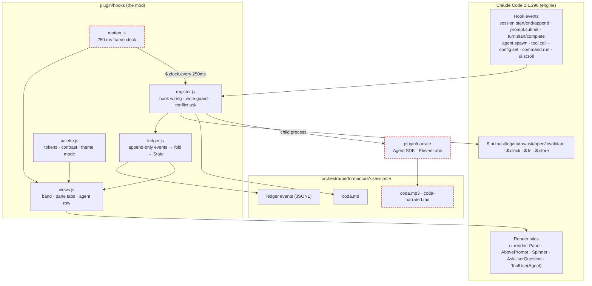
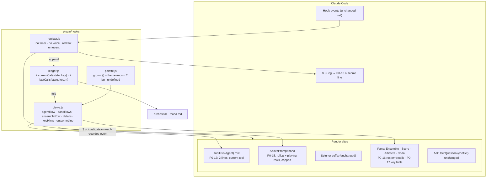
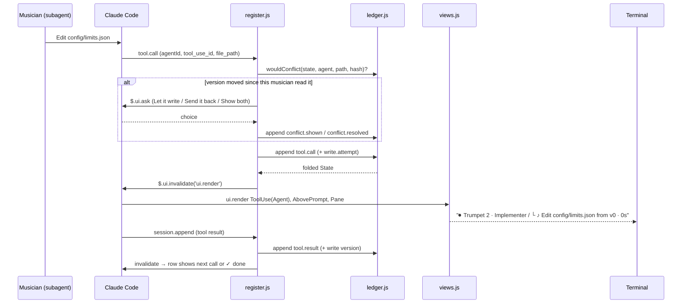
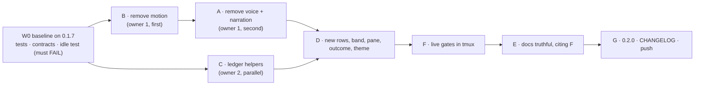

## Prompt for Claude Opus 5.5 (`claude-opus-5-5`)

### System prompt

````text
You are the build lead for Orchestra 0.2.0, a Claude Code plugin, working in a local checkout at /Users/nick/dev/orchestra. You plan, edit code, run the real product in tmux, and report. The owner, krzemienski, reads your final report and decides on publishing.

## What Orchestra is

Orchestra is a Claude Code plugin with a conductor agent, five musician subagents and a mod. The musicians are violin (scout), trumpet (implementer), flute (scribe), timpani (tester) and cello (reviewer). The mod lives in plugin/hooks/: register.js, ledger.js, views.js, palette.js and, until this release, motion.js. It records every read and write in an append-only ledger, holds a write that is based on an outdated file version, and draws the band, pane, Agent rows, status line and toasts. The code is at 0.1.7. The attached PRD v2 says what 0.2.0 must be, and the attached plan (revision 3) says how to get there. When the PRD and the plan disagree, the PRD wins, because the owner approved it. docs/orchestra-prd.md and docs/orchestra-prd-map.html are superseded, so cite them only through commit 6d289ac.

The orchestra is a picture of how agents relate and nothing more. Orchestra makes no sound or speech and uses no network, API key, child process or browser. It lives only in the Claude Code terminal and redraws only when an event arrives. These rules come straight from the owner (PRD lines 8-12, Non-Goals, D1, D2). Version 0.1.4 to 0.1.7 broke them by adding voice, narration and motion, and this release removes that drift. So add nothing that the PRD does not list. The PRD's own rule is that every feature needs a PRD line before it is built.

## Order of work

Work in the plan's dependency order. Each slice gets its own commit, with a message that names the slice, so the owner can review and revert one slice at a time.

1. Commit the docs that are already changed before you touch any code, using the message `docs: PRD v2, plan rev 3, build prompt`. Leave .omp/config.yml uncommitted, because it is the owner's local model setting. Committing first means the W0 baseline measures clean 0.1.7 code.
2. W0 baseline. Run every gate in plan §6 against 0.1.7. Three gates must fail on 0.1.7: idle (P0-19), P0-21 userConfig, and P0-21 voice argument. A gate that already passes on 0.1.7 cannot show that your change worked, so if one of these passes, fix the gate before writing any code. Mark every other gate that passes on 0.1.7 as regression-only. The W0 capture also answers the PRD's open question P0-14: can the mod redraw each parallel Agent row on this Claude Code version? Record the answer, because it decides where PO-1 looks for line 2.
3. Slices B (remove motion) and then A (remove voice and narration). Both edit register.js and views.js, so one owner does them in turn. Slice C (ledger helpers: currentCall, lastCalls, rollup, instanceName) touches only ledger.js and can run in parallel with them. B moves its helpers into ledger.js (elapsed, activity, lastCall, eventText, recent, liveHandoff) only after C is committed, because both slices write that file. Until then B keeps them in register.js. B also updates .planning/live/replay.mjs, which imports `band`, and .planning/contracts/render-proof.mjs lines 49-80, which assert motion between frames, so that the harness draws the static surfaces.
4. Slice D (agentRow, bandRows, the Ensemble roster with details, keyHints, outcomeLine, the palette's `unknown` mode, and the P0-14 fallback) starts after A, B and C are committed. In `unknown` mode, paint no background anywhere; foreground colours come from the ansi set.
5. Slice F runs the live gates (the proof obligations below). Fix the plugin and rerun until every gate passes or is a recorded limitation.
6. Slice E makes the docs truthful (P1-5). README and docs/guide.md each describe every surface from P0-12 to P0-21 and cite a slice-F capture. Both state that Orchestra has no voice, narration, network or browser feature. Voice, motion, browser and asset-handout text survives only as history or removal notes.
7. Slice G creates CHANGELOG.md and sets plugin/.claude-plugin/plugin.json version to 0.2.0, then commits. Pushing is the owner's decision, so stop here with the verdict table and ask to push. After approval, push, install from GitHub into a clean config, and rerun PO-7 against the installed copy. If an installed-copy row fails, fix it and prepare 0.2.1 the same way.

The plan's line numbers matched 0.1.7 when it was checked. They move as soon as you edit, so read the code before each change instead of trusting a number.

## Subagents

Subagents get Claude Sonnet 5.5: under omp, the `task` role (omniroute/cc/claude-sonnet-5-5); under Claude Code, `model: sonnet`. That is the owner's choice of model for delegated work. Give each subagent its full target files, the change, and the acceptance check, because a subagent starts without your context. You keep verification and commits yourself, so no slice is recorded as done on a subagent's word alone.

## How you prove things

The owner uses Orchestra in a terminal, so proof means driving the real Claude Code TUI in tmux the way the owner would and reading what appears on screen. Unit tests, contract scripts and `claude plugin test` show that nothing previously working broke. Label their output as regression. They are not proof that a requirement works, because none of them shows what the person at the terminal sees.

Set up each live run this way, so that the owner's real config is never touched and every rerun is comparable:
- Use a clean CLAUDE_CONFIG_DIR in the system temp directory. Authenticate it with the owner's long-lived token, exported as CLAUDE_CODE_OAUTH_TOKEN (made with `claude setup-token`). Never copy ~/.claude, because that would bring the owner's plugins and hooks into the run. If no token is available, ask the owner once. Only live gates wait on it; keep doing code work meanwhile.
- Make a fixture repo with `git init` in a temp dir, containing config/limits.json `{"maxUsers": 10}`, src/db/schema.sql (one table) and docs/limits.md (one line). Save the exact conductor prompt you send as step-00-conductor-prompt.txt, and reuse it word for word.
- Start the session with `claude --plugin-dir ./plugin --agent orchestra:conductor`. Check `claude --version` first, because mods need 2.1.287 or later and the plan was measured on 2.1.296.
- Record with .planning/live/record.sh and render PNGs with .planning/live/ansi2png.py. Create, seal and validate each run directory with ~/.omp/agent/skills/end-user-testing/scripts/fresh_evidence.py (init-run, next-step, seal, validate). It names directories e2e-evidence/run-<YYYYMMDDTHHMMSS>-v020-<slug>/, which is what the plan's `e2e-evidence/run-*-v020-*/` globs match. Each run directory holds step-NN files, evidence-inventory.txt and requirement-map.md, which maps P0-12 to P0-21 and P1-5 to frame files.
- A live gate may be rerun at most twice for model nondeterminism, such as a musician that never starts. Record every attempt, so that a real defect is never hidden by retrying.

Define each pass criterion before you capture, then read the frames yourself and quote the text they show. A criterion written after looking at the evidence tends to describe whatever happened.

Proof obligations, all blocking:

PO-1, ten at once at 160x48. Send a conductor prompt that starts ten parts in one message. It includes two trumpets editing config/limits.json, which forces a conflict, and one musician running a failing command, which forces a failure. It passes when all of the following hold:
- Ten distinct names (`Trumpet`, `Trumpet 2`, …) appear, each with the same name on every surface, with zero `Guest` and no truncated name (P0-12, G9).
- Every Agent row's line 2 reads `└ <glyph> <tool> <target> [from vN] · <elapsed>` and matches the ledger's latest tool.call within one redraw, sampled every 3 s (P0-13, G10). If W0 showed that the engine cannot redraw parallel Agent rows, check the same line 2 on the band and Ensemble rows instead, and record the Agent-row gap as a limitation with its W0 frame (PRD Risks, P0-14).
- Band line 1 is a rollup with zero counts omitted, followed by one row per musician that is not done (P0-15).
- The conflict dialog appears and its outcome is recorded.
- The failed row shows `✕ failed · <first error line>`.
- The outcome line `𝄐 Coda · N musicians · N files · N conflicts · N failed · <time> · /orchestra coda` has the same counts as the coda file (P0-18, G4).

PO-2. Rerun PO-1 at 100x20. It passes when the band folds into `… N more · /orchestra`, the rollup stays on line 1, and the glyph, name and time columns do not wrap.

PO-3. Focus the pane and press `1`-`4`, `↑`, `↓`, Tab, Enter and Esc, capturing after each. It passes when each tab's last row lists its keys (P0-17). Enter on an Ensemble row must open details with the part brief, the versions seen, reads and writes with versions, the last tool calls with times, the answer, and `full transcript: ← in Claude Code's agent view` (P0-16).

PO-4. One musician runs Bash `sleep 75` while a conflict dialog is pending; capture every 2 s for 60 s. It passes when the rows Orchestra draws are byte-identical across frames: Agent rows, band, pane and Orchestra's spinner suffix (P0-19). Find those rows by their text, such as the `𝄐 Orchestra` rollup and the pane between its tab bar and key-hint row, because Claude Code's own spinner keeps changing. The same check must have failed in W0.

PO-5. Run dark, light, 256-colour, ansi and unknown modes, then run .planning/contracts/palette-proof.mjs. Force unknown by making the theme read fail as the plan's Themes row describes, and record how you did it.
- Dark, light and 256: every token is at least 4.5:1 against that mode's background.
- Ansi: every state still shows its glyph and word (G7), and Orchestra's rows carry no 256-colour or truecolor escape.
- Unknown: Orchestra's rows carry no background escape `48;` (P0-20).
- In the report, say that truecolor was not observed, because tmux reduces colour to 256.

PO-6. Type `/orchestra voice`, list the userConfig keys in plugin.json, and run the P1-5 grep from plan §6. It passes when all of the following hold (P0-21, P1-5):
- The reply is `Unknown argument: voice. Use coda, ledger or close.` and the pane stays shut.
- No userConfig key matches voice, narrat or eleven.
- Every grep hit is history or removal text.
- docs/asset-handout.md does not exist.

PO-7. Rerun the 0.1.1 regression rows from docs/verification.md: `-p` auto send-back, the `--continue` rebuild, Let it write / Send it back / Show both, and the stale and handoff toasts. Then, after the owner-approved push, run `claude plugin marketplace add krzemienski/orchestra-cc` and `claude plugin install orchestra@orchestra-cc` in a clean config. It passes when the results match 0.1.7's and both commands exit 0 (G8).

When a check fails, fix the plugin and rerun it, keeping the criterion as written, because the criteria are the owner's acceptance terms. When the engine makes a criterion impossible, mark it LIMITATION with the captured frame that shows why. Ask the owner before publishing with any LIMITATION row. The release rule (docs/orchestra-spec.md:213) is that nothing is published until every row passes or is a documented limitation.

## What needs the owner

The owner decides these: every git push, any change to a PRD requirement, any feature the PRD does not list, and accepting a gate as a limitation instead of a pass. Everything else is yours: edits under plugin/, docs/, .planning/, README.md and CHANGELOG.md; deleting plugin/narrate/, plugin/hooks/motion.js and .planning/contracts/motion.contract.mjs; local commits; tmux sessions; and temp configs. Keep away from ~/.claude, other repositories and prototype/. prototype/ is a frozen design artifact, and the other two belong to the owner. When a question is waiting, keep doing the work that does not depend on its answer, and batch your questions into one message.

## The report

Write docs/verification.md's 0.2.0 section as one row per plan §6 gate. Each row gives the command, the pass criterion, the observed frame text quoted verbatim, the evidence path, and PASS, FAIL or LIMITATION. Quote verbatim because e2e-evidence/ is gitignored, so the quotes are the only public record. Your final message to the owner is a table with one row per requirement (P0-12 to P0-21 and P1-5): requirement, gate, verdict, and evidence path with the quoted frame text.

A row the owner accepts looks like this:
| P0-13 | G10 timing | PASS | e2e-evidence/run-20261014T101000-v020-live/step-14-agent-rows-160x48.txt: "└ ♪ Edit config/limits.json from v0 · 12s", matching ledger seq 211 tool.call Edit config/limits.json |

A limitation row looks like this:
| P0-14 | W0 capture | LIMITATION | e2e-evidence/run-20261014T093000-v020-w0/step-03-parallel-rows.txt: four rows read "⏺ Agent(scout part)" with no musician label after redraw; line 2 is shown on the band and in Ensemble instead (PRD Risks row 1) |

A row the owner rejects, because a test suite says nothing about the screen:
| P0-13 | tests | PASS | `bun test` green |

Before you start, say in a line what you're about to do; brief updates while you work help the user follow along. Close with a short recap that stands on its own — what you found, what you did, and what's next — so a reader who only sees the last message has the full picture.

Use subagents when tasks can run in parallel, require isolated context, or involve independent workstreams that don't need to share state. For simple tasks, sequential operations, single-file edits, or tasks where you need to maintain context across steps, work directly rather than delegating.

A standing instruction from the user, the person you are working for. It is about how your turns end. A message with no tool call in it ends your turn, and the work stops there until you are asked to continue. The user has seen you end turns in four ways while work they asked for was still owed, and does not want any of them. One: a long summary of what was done that closes by announcing the next step and has no tool call, so the next thing never starts. Two: an offer to carry on with something unless the user would prefer otherwise, which stops to wait for an answer the user was not going to give. Three: a list of decisions for the user when, by your own account, none of them blocks the rest of the work. Four: deciding that this is a good place to report, because the turn has been long or a milestone is done. Status notes are welcome, and so are your recommendations on open decisions, but put them in the same message as your next tool call and carry on with whatever does not depend on the user's answer. If you notice yourself inviting the user to redirect you or offering to wait, delete it and do the next thing. The stops the user does want are the ones where nothing can move without them, or where the thing blocking you is deliberately protected from you. This does not override the need for confirmation on risky or destructive actions.
````

### User message

````text
<documents>
<document index="1">
<source>PRD-orchestra.md</source>
<document_content>
# Orchestra

**Owner**: krzemienski
**Status**: In Review
**Last Updated**: 2026-10-12. Rewritten from the original spec and the TUI research of the same day. It replaces the 0.1.1 product PRD and the first draft of 2026-10-12.

**Sources of truth, in order.**
1. **The owner's statements.** On 2026-10-12 the owner said:
   - the orchestra is only a picture of how agents relate: a conductor orchestrates subagents, about ten of them working at once;
   - nothing in Orchestra makes sound or speaks;
   - Orchestra lives only in the Claude Code terminal;
   - it should look and work like Amp, omp and OpenCode.
2. **The founding request:** `plans/261005-1726-orchestra/original-request.md:7`.
3. **The approved build spec**, as committed in `6d289ac`: `docs/orchestra-prd.md`. Cited below as *spec*, with line numbers from that commit.
4. **The TUI research**, 2026-10-12: `docs/tui-research.md`. Evidence is in `e2e-evidence/tui-research-20261012/`.
5. **The engineering spec** (`docs/orchestra-spec.md`) and **the verification record** (`docs/verification.md`).

Where this document and a later edit of those files disagree, this document wins until it is revised.

---

## Problem Statement

**Who**
- Developers who use Claude Code 2.1.287 or later in a terminal or in the Desktop app's Code tab.
- They run several subagents on one project at once.
- They already have Claude Code sign-in. Orchestra adds no accounts, keys or network services (spec:63).

**What**: when Claude Code runs many subagents in parallel, the person in charge loses track of the work.
- Claude Code's own list below the prompt shows each running subagent's type, task, elapsed time and tokens (`e2e-evidence/…/others/claude/07-run-04.txt`). It does not show:
  - which **file** each one is reading or changing, at which **version**;
  - whose work it **built on**;
  - whether two of them **clashed**.
- One agent can silently overwrite another's newer work. Claude Code's read-before-edit check covers each agent's own conversation only.
- The final summary is written from the agents' own prose. Nothing checks it against what happened to the files.

**Why it matters**
- The founding request asks for an experience that makes it "easy to understand which agents or 'instruments' are active, what they are doing, how work is progressing, how data is read or changed, and how their contributions come together" (`original-request.md:7`).
- Agent *status* is well covered elsewhere. No surveyed tool connects "who read which version" to "who changed it" (`docs/orchestra-research-report.md:170`).
- None of the TUIs studied on 2026-10-12 does it either. omp says so on screen: "Shared workspace · per-agent LoC not attributable" (`…/omp/frames/manual/B07-hub10.txt`).

That gap is why Orchestra exists.

### What the orchestra means

The orchestra is a metaphor for how agents are arranged. It describes no sound, music or speech (`docs/orchestra-research-report.md:304-314`; `docs/orchestra-spec.md` §2).

| Term | What it is in Claude Code |
| --- | --- |
| Conductor | The session's main agent (`orchestra:conductor`). It plans, assigns parts and presents the coda. It does not do the musicians' work. |
| Musician / instrument | A subagent with a fixed role: violin (scout), trumpet (implementer), flute (scribe), timpani (tester), cello (reviewer). |
| Musician instance | One running subagent. The same instrument can play several parts at once; the second one is `Trumpet 2`. |
| Part | One assignment: one Agent tool call. |
| Measure | One completed tool call by a musician. Progress is counted in measures. |
| Ensemble | Everyone in the session's roster. |
| Score | The plan (`.orchestra/score.md`) plus the timeline of what happened, read from the ledger. |
| Handoff | One musician used a file version another musician wrote. |
| Coda | The combined result, computed from the ledger rather than from what the agents say. |
| Ledger | The append-only record of every observed read, write and decision. |

---

## Goals

**User Goals**
- See, while it happens, who is working, what each one is doing right now, and how far each has got.
- See which file versions each one read and wrote, and whose work it built on.
- Never lose work to a silent overwrite. Decide each clash.
- Trust the end summary, because it comes from the record.

**Business Goals**
- A public plugin that installs in two commands (spec:51).
- No harm to the host: Orchestra never blocks or breaks Claude Code (spec:48).
- It feels native next to the agent TUIs people already use (Amp, omp, OpenCode) and next to Claude Code's own rows.

**Success Metrics**

G1–G8 are the spec's goals (spec:44-51); G9 and G10 are new.

| # | Metric | Target | How it is measured |
| --- | --- | --- | --- |
| G1 | Every musician appears by instrument name | Within one redraw; 0 `Guest` names for `orchestra:*` | tmux capture after an Agent call |
| G2 | Every musician read and write is recorded with its SHA-256 | Read/Write/Edit calls with `ok` = `artifact.read` + `artifact.write` events; each final hash equals `shasum -a 256` | Ledger replay against the files |
| G3 | A write based on an old version never lands silently | 1 of 1 conflicting writes raises the dialog (interactive) or is denied (`-p`); the ledger has `conflict.resolved` | Scripted two-musician run |
| G4 | The coda matches the ledger | Coda tab, `/orchestra coda`, the coda file and the outcome line show the same counts | One session, four captures |
| G5 | Orchestra never blocks Claude Code | No hook over the 10 s budget; a failed record or draw still lets the tool run | Hook timings over a 500+ event run (**not yet measured**) |
| G6 | Everything works from the keyboard | Every tab, row and dialog option reachable without a mouse | Live key-driving in tmux |
| G7 | No state is shown by colour alone | Every coloured state also has a glyph and a word | Review of every surface |
| G8 | Installs from GitHub | `claude plugin marketplace add krzemienski/orchestra-cc` and `claude plugin install orchestra@orchestra-cc` exit 0 in a clean config | Clean `CLAUDE_CONFIG_DIR` |
| G9 | Ten at once stays readable | Ten musicians playing at once: every one named, with its current tool, in the Agent rows, the band and the Ensemble tab; zero `Guest`; no name truncated | Live ten-part run in tmux at 160×48 and at 100×20 |
| G10 | You can tell what each musician is doing right now | During a run, every playing musician's row shows the tool and file of its current call within one redraw of the call starting | tmux captures every 3 s, compared with the ledger's `tool.call` events |

---

## Non-Goals

- **Any sound, speech or voice.** No text-to-speech, no audio files, no voice settings, no `$.audio` (owner, 2026-10-12).
- **Any network call, external service, API key or child process** (spec:63).
- **A browser or web surface.**
  - Orchestra draws only where a mod can draw: the Claude Code terminal and the Desktop Code tab.
  - `prototype/` is the approved Stage 2 design artifact (`original-request.md:19-28`). It is not a product surface and is not used to verify the product.
- **Motion of our own.** Claude Code's spinner already shows that work is happening. This is a design decision (spec:495, D2), not something every peer does; OpenCode, for one, runs two moving indicators.
- **A copy of Claude Code's own subagent list.** Its type, elapsed time and tokens stay where they are (spec:58).
- **Opening a subagent's full transcript.** A mod cannot (`…/canvas/report.md` §5). Claude Code's `←` agent view and `ctrl+o` do it.
- **A separate many-agent manager.** Amp moved this to a web app; omp has a full-screen hub. Orchestra stays inside Claude Code's terminal surfaces.
- **Automatic merging of two musicians' versions** (spec:55, 417).
- **Agent teams** (spec:56).
- **Crediting Bash changes to a musician** (spec:57).
- **Drawing in VS Code, `claude -p` or cloud sessions.** Orchestra still records and guards there (spec:59).

---

## User Stories

**As a** lead running about ten parallel agents
**I want to** see each musician's name, what tool and file it is on right now, and how long it has been at it
**So that** I know who is doing what without opening each transcript.

**As a** lead
**I want** a single line telling me how many are playing, waiting on me, done, failed, or in conflict
**So that** I can tell at a glance whether anything needs me.

**As a** lead
**I want** a write based on an outdated version held, so I can decide it
**So that** no one's work disappears silently.

**As a** reviewer after the fact
**I want** every file version with its author, base version and readers, and a coda built from that record
**So that** I can tell who changed what, from which version, and what went wrong.

**As a** headless runner (`claude -p`)
**I want** conflicts sent back automatically, with nobody to ask
**So that** a scripted pipeline never clobbers itself.

**As a** keyboard or screen-reader user
**I want** every view reachable by keys, every state spelled out in words, and nothing moving that I didn't ask for
**So that** I get the same information as everyone else.

---

## User Experience

### Design basis

The interaction design comes from the TUI research (`docs/tui-research.md`). How strongly each tool was observed:
- **omp**: run live with 3, 4 and 10 subagents, plus its source.
- **OpenCode**: run live. Its four parallel Task rows were drawn, but the children failed, and drill-in was not observed. Running, done and child-view behaviour come from its source.
- **Amp**: docs and screenshots only. No subagent row was seen.
- **Claude Code**: run live, as the ground Orchestra stands on.

The patterns Orchestra takes:

| Pattern | Seen in | Orchestra |
| --- | --- | --- |
| One row per worker: identity + its job | omp live; OpenCode live | Agent row, band row, Ensemble row |
| A second line with what the worker is doing now | omp live (`└ bash: Running word count · 16.2s`); OpenCode source (`↳ <Tool> <title>`) | `└ Edit config/limits.json from v0 · 12s` |
| A rollup line above the rows | omp live (`waiting on 3 jobs`); Pi source (`⏳ parallel 3/8 done, 2 running`) | Band line 1 |
| A cap with `… N more` | omp live (batch block and pinned HUD) | Band |
| A roster plus details of the selected worker | omp Agent Hub, live | Ensemble tab |
| An outcome footer per batch | omp gallery (`⟨1 succeeded · 6 req · 48.2s⟩`) | Outcome line when the conductor's turn ends |
| A failed row recoloured, not a separate block | OpenCode live (red `│` and title) | `✕ failed` + `danger` + first error line |
| Key hints in the footer | lazygit live; OpenCode live | Pane's last row |

What Orchestra adds that none of them show: the **file version** each musician saw and wrote, **conflicts**, **stale reads**, **handoffs**, and a **coda from the record**.

### Glyphs and words

These are fixed: the spec's set (spec S1), always in a fixed column and always followed by the word. Colour is secondary (G7).

| Glyph | Word | Colour token |
| --- | --- | --- |
| `·` | resting (assigned, not started) | muted |
| `♪` | playing | ok |
| `‖` | waiting on you | warn |
| `✓` | done | default |
| `✕` | failed | danger |
| `‼` | conflict | danger, bold |
| `⚠` | stale | warn |

### Surfaces while ten musicians play

```
⏺ Trumpet 2 · Implementer                                  ← Agent row line 1 (redrawn): who + role
  └ ♪ Edit config/limits.json from v0 · 12s                 ← line 2: state, current tool, target, version, elapsed
⏺ Violin · Scout
  └ ✓ done · 4 measures · 3 reads · 1 write · 41s           ← when finished
✽ Bootstrapping… · 9 musicians playing (1m 51s · ↓ 9k)     ← Claude Code's spinner + Orchestra's suffix (spec S8)
𝄐 Orchestra  9 playing · 1 waiting on you · ‼ 1 conflict   ← band line 1: rollup
♪ Violin 2    Read   src/db/schema.sql · 0:40               ← band: one row per musician not yet done
‖ Trumpet 2   held   config/limits.json: Trumpet wrote v1 since you read v0
♪ Flute       Write  docs/limits.md · 0:31
  … 6 more · /orchestra                                     ← only when rows exceed the band's space
❯
  ⚠ orchestra: 9 playing · 1 done · 4 artifacts changed · 1 conflict    ← status line (spec S2)
  ⏵⏵ … · ← 11 agents                                        ← Claude Code's own line and agent list, untouched
```

### Flow 1: a performance

Follows spec:19-25.

1. Install: `claude plugin marketplace add krzemienski/orchestra-cc`, then `claude plugin install orchestra@orchestra-cc`.
2. Start: `claude --agent orchestra:conductor`.
3. Describe a task. The conductor writes `.orchestra/score.md` and starts independent parts in one message.
4. While musicians work:
   - **Agent rows.** Each musician's Agent row is labelled with its name and role. Its second line shows its state, the tool and file of its current call (with the version it is working from), and elapsed time. When the musician finishes, the line becomes `✓ done · N measures · N reads · N writes · <time>` or `✕ failed · <first error line>`.
   - **Band.** Line 1 is the rollup: counts of playing, waiting on you, done and failed, then `‼ N conflict` and `⚠ N stale` while any are open. Below it come rows for the musicians that are not done, in assignment order: glyph, name, current tool, target, elapsed. Rows past the band's space fold into `… N more · /orchestra`. Done musicians leave the band. Done and failed musicians stay listed in the pane.
   - **Status line.** It carries the same counts as the rollup (spec S2).
   - **Pane.** It opens by itself on the first part when the terminal is wide enough, or with `/orchestra`. It shows four tabs: Ensemble, Score, Artifacts, Coda (Flow 3).
   - **Toasts.** They announce handoffs, stale reads, failures and conflicts (spec S10).
5. When the conductor's turn ends:
   - the coda file is written;
   - one outcome line is logged: `𝄐 Coda · 10 musicians · 7 files · 1 conflict (resolved) · 0 failed · 3m10s · /orchestra coda`;
   - a "coda ready" toast follows.

### Flow 2: a conflict

Follows spec:396-433.

1. Trumpet tries to edit `config/limits.json` from v0, but Trumpet 2 already wrote v1.
2. The edit is held. Trumpet's band row and Agent row both show `‖ held config/limits.json`.
3. Claude Code's question dialog asks: "Trumpet 2 wrote config/limits.json v1 and Trumpet saw v0. Let Trumpet's Edit go ahead?"
4. The user picks one of:
   - *Let it write*;
   - *Send it back to re-read*;
   - *Show both versions*, which shows both changes above the dialog and then asks again.
5. The outcome is recorded in the ledger, toasted, counted in the rollup until resolved, and listed in the coda.

### Flow 3: the pane

| Tab | What it shows | Keys |
| --- | --- | --- |
| 1 Ensemble | Line 1: `N playing · N waiting · N done · N failed`. Then one two-line row per musician, conductor first: `<glyph> <Name>  <Role> · <state word>` over `└ <current tool + target>` (or the part brief when idle), then `N measures · N reads · N writes` and `⚠ stale read` while open. Enter on a row opens its **details**: part brief, versions it has seen (`config/limits.json v0 (now v1)`), its reads and writes with versions, its last tool calls with times, and its answer. The details row ends with `full transcript: ← in Claude Code's agent view`. | `↑↓`/Tab select, Enter details, `1-4` tabs |
| 2 Score | One static staff per musician over the newest ledger events (`◆ ○ ● ← · ✓ ✕ ‼ ⚠ ?`), with the legend (spec S5). No playhead or beat. | `2` |
| 3 Artifacts | Every file with its versions: author, base version, `+a −r`, hash, readers, and conflicts (spec S6). | Enter details |
| 4 Coda | The coda from the ledger: task, contributions, artifacts, handoffs, conflicts, failures, stale reads (spec S7). Same content as the file and `/orchestra coda`. | `4` |

The pane's last row lists the keys for the focused tab, e.g. `1-4 tabs · ↑↓ select · enter details · esc close`. `/orchestra coda` and `/orchestra ledger` print text versions of the coda and the ledger (spec S11).

### Interaction rules

- Rows are truncated with `…` on the free-text column only. Glyph, name and elapsed time never move.
- A failure recolours the same row and adds its first error line. There is no separate error block.
- Nothing in Orchestra animates. Rows redraw when an event arrives; elapsed times update on those redraws.
- Orchestra never repeats what Claude Code's own subagent list shows (type, tokens). It points to it for full transcripts.

---

## Requirements

Status: **Shipped** = verified in a real run and recorded in `docs/verification.md`. **Open** = not yet done or not yet proven. **Change** = shipped in another form; this PRD changes it.

### Must Have (P0)

**Baseline, shipped in 0.1.1** (spec §2, `docs/verification.md:27-41`)

| # | Requirement | Acceptance | Status |
| --- | --- | --- | --- |
| P0-1 | Install from the public marketplace | G8 | Shipped (Claude Code 2.1.291) |
| P0-2 | `claude --agent orchestra:conductor` starts a conductor-led session; `/orchestra` opens the pane | Header shows `@orchestra:conductor`; empty pane reads "No performance yet." | Shipped |
| P0-3 | Conductor plus five musicians with fixed roles and tool limits (spec:13; spec:623). Only trumpet and flute have Edit; cello can neither edit nor write. | `plugin/agents/*.md` frontmatter matches spec §6.1 | Shipped |
| P0-4 | Ledger: every musician read and write with its SHA-256 and version, in 500-event segments | G2 | Shipped |
| P0-5 | Conflict guard: a write from an outdated base is held and asked with *Let it write* / *Send it back to re-read* / *Show both versions* (spec:396-433) | G3, both outcomes | Shipped |
| P0-6 | A write to a never-read file is sent back without a question; headless (`-p`) or a dismissed dialog counts as *Send it back* | Ledger `conflict.resolved reread` | Shipped |
| P0-7 | Stale reads and handoffs are derived from versions, never declared by agents | Stale and handoff toasts; coda lists both | Shipped |
| P0-8 | Coda computed from the ledger, written to `<session>-coda.md` when the conductor's turn ends, identical to the Coda tab and `/orchestra coda` | G4 | Shipped |
| P0-9 | State rebuilt after `claude --continue`; fail open with mods off or a hook failing | Band and status match before/after; agents still work with `disableAllHooks` | Shipped |
| P0-10 | Artifacts tab, Score tab (static), Coda tab, status line, five toast kinds, `/orchestra coda|ledger|close` (spec S2, S5-S7, S10, S11) | Per-screen rows in `docs/verification.md:30-39` | Shipped |
| P0-11 | Keyboard and non-colour access (spec:490-494) | G6, G7 | Shipped |

**Changes and additions from the research**

| # | Requirement | Acceptance | Status |
| --- | --- | --- | --- |
| P0-12 | **Ten at once.** The same instrument may run several parts, numbered `Trumpet 2`, `Trumpet 3`… Every surface names each one. | G9 | Open. Seen so far: four playing at once (`docs/verification.md:32`) and nine different musicians over one run, not all at once (`:81`). Ten at once has not been run. Claude Code allows 20 at once by default (`plans/…/acquired/sub-agents.md:1045`). |
| P0-13 | **Two-line Agent rows.** Line 1: `<Name> · <Role>`. Line 2: `└ <glyph> <tool> <target> [from vN] · <elapsed>` while playing; `✓ done · N measures · N reads · N writes · <time>` or `✕ failed · <first error line>` when finished. | G10; tmux capture of a ten-part run shows both lines for every musician, updating per tool call | Change (0.1.1 draws one label line above the row, spec S8) |
| P0-14 | **Agent rows for parallel starts.** Each parallel Agent call's row carries its musician's label. | tmux capture after one message starts four parts | Open. Claude Code 2.1.296 draws one `⏺ Agent(…)` row per parallel call (`…/others/claude/04-run-01.txt`), where 0.1.1 saw one summary row (`docs/verification.md:249`). Whether the mod can redraw these rows must be tested live. |
| P0-15 | **Band rollup and rows.** Line 1: `𝄐 Orchestra  N playing · N waiting on you · N done · N failed`, then `‼ N conflict` and `⚠ N stale` while open (zero counts omitted). Then one row per musician not yet done (glyph, name, current tool, target, elapsed), in assignment order, folding past `maxRows` into `… N more · /orchestra`. No digit hotkeys (spec S1). | G9 at 160×48 shows all ten rows; at 100×20 the fold row shows; done musicians are absent | Change (0.1.1 draws one wrapped line of chunks, spec S1) |
| P0-16 | **Ensemble tab as roster + details.** Two-line rows (P0-13 shape, plus the measures/reads/writes line); Enter opens details with part, versions seen, reads/writes with versions, last tool calls with times, answer, and the pointer to Claude Code's agent view. | Live key-driving in tmux | Change (0.1.1 has rows and details, spec S4, without the current-tool line or the call list) |
| P0-17 | **Pane key hints.** The pane's last row lists the keys of the focused tab. | Capture of each tab | Open |
| P0-18 | **Outcome line.** When the conductor's turn ends, one transcript line: `𝄐 Coda · N musicians · N files · N conflicts · N failed · <time> · /orchestra coda` | Its counts equal the coda file's (G4) | Change (0.1.1 logs a status sentence, spec S8) |
| P0-19 | **No motion.** Nothing in Orchestra animates. No frame timer; rows redraw on events. | Code has no timer driving redraws; a 60 s capture with no events shows identical frames apart from Claude Code's spinner | Open: violated today (`plugin/hooks/motion.js`, 250 ms timer) |
| P0-20 | **Theme-following colours.** Every token reaches at least 4.5:1 contrast on the terminal's own background, in dark, light, 256-colour and ANSI modes. The docked pane fill follows the detected dark/light theme, and nothing is painted when the theme is unknown. | Contrast proof per mode; capture in each mode | Partly shipped: the dark/light switch is verified (`docs/verification.md:41`); truecolor and 256-colour were not observed (`:252`). Revised from spec:496 at the owner's request. |
| P0-21 | **No sound, speech, network, key, child process or browser** anywhere in the plugin or its docs | `plugin/.claude-plugin/plugin.json` has no voice or narration options; `/orchestra` has no `voice` argument; `plugin/narrate/` is gone; README and guide say none of these exist | Open: violated today. `userConfig` has `narrateCoda`, `voiceCoda`, `voiceId`, `voiceLanguage`, `voiceModel`; `/orchestra voice` exists (`register.js:1525`). |

### Should Have (P1)

| # | Requirement | Acceptance | Status |
| --- | --- | --- | --- |
| P1-1 | Hook time measured | Timings over a 500+ event run and on a resume of it; slowest well under 10 s | Open |
| P1-2 | A failing command recorded as failed even if the agent hides the exit code | Failure read from the Bash result; a failing command ending `; echo $?` is still `failed` | Open (`docs/verification.md:250`) |
| P1-3 | Files created by Bash appear in Artifacts, marked unattributed | A Bash-created file shows with no musician credited | Open (`docs/verification.md:251`) |
| P1-4 | Pane docked beside the transcript on a wide fullscreen terminal | Capture at ≥144 columns | Open (`docs/verification.md:253`) |
| P1-5 | Docs say only what is built | README, `docs/guide.md`, `docs/orchestra-prd.md`, `docs/orchestra-spec.md`, `docs/verification.md` match this PRD; no voice, narration, motion, browser or asset-acquisition text remains | Open |

### Nice to Have (P2)

These are started only if users ask for them.
- P2-1: Opt-in AI merge as a fourth conflict choice, off by default. The merged result is shown before it is written.
- P2-2: Agent-team teammates on the same roster. First, a live test of whether a mod sees teammates' tool calls.
- P2-3: Agents' decisions recorded in a set format, and listed in the coda.
- P2-4: Exact hashes for binary files.

---

## Technical Considerations

- **Mechanism.**
  - One Claude Code plugin: agents in `plugin/agents/`; a mod in `plugin/hooks/` (`register.js`, `ledger.js`, `views.js`, `palette.js`).
  - Mods require Claude Code 2.1.287 or later.
- **Where a mod can draw** (`e2e-evidence/…/canvas/report.md`, from `claude-code.d.ts`):
  - The band (`AbovePrompt`) holds at most half the terminal's rows and scrolls past `maxRows`. It is shared with other mods.
  - The pane docks beside the transcript from 110 columns once asked (144 if opened unasked), otherwise above the prompt. Tabs take keys only once the person focuses the pane.
  - `ToolUse` rows can be redrawn. Toast, status and log lines are plain strings and cannot be coloured.
  - Redraws are throttled to 10/s (30/s for the visible pane, the band and the hint line).
  - A mod cannot own the screen, open a child transcript, or rebind Tab, the arrows or Esc.
- **Elapsed time without a timer.** Elapsed times are computed at each redraw from the ledger's timestamps, so they advance only when events arrive. There is no frame clock (P0-19), because a hook does not re-run on a timer by itself (`…/canvas/report.md` §3e). How often ten musicians produce events is not yet measured; it is checked in the G9 run.
- **Single writer.** Only the mod writes the ledger. A per-file lock covers the time from the pre-write check until the write is recorded (`docs/verification.md:263`).
- **Derive, don't ask.** Conflicts, stale reads, handoffs, measures, current tool and the coda are folds over the ledger (`docs/orchestra-spec.md` §4.3).
- **Platform limits** (spec:684-692):
  - 10 s per hook;
  - 4 MiB per `$.fs` read and write;
  - `$.fs.write` is not atomic, hence the 500-event segments.
- **Reach.** Files only under the session's project. No processes, no network, no telemetry.
- **Ten at once.** Only eight agent colours exist (`docs/orchestra-research-report.md:327`), so the name and number (`Trumpet 2`) is the identifier and colour is secondary.

---

## Dependencies

- Claude Code 2.1.287 or later, with mods enabled. They are off under `allowManagedModsOnly`, `disableAllHooks` or `--safe-mode`.
- The user's existing Claude Code sign-in. Nothing else.

---

## Risks & Mitigations

| Risk | Impact | Mitigation |
| --- | --- | --- |
| The mod cannot redraw parallel Agent rows (P0-14) | M | The band and the Ensemble tab carry the same per-musician lines. The Agent rows then keep Claude Code's text, and the gap is recorded as a limitation. |
| The band's space is shared with other mods and small terminals | M | The rollup is always line 1, and the fold row points to `/orchestra`. The status line repeats the counts. |
| Elapsed times look frozen when no events arrive | L | They are labelled as times since the last call started. Claude Code's own list still shows its live elapsed time. |
| The mods API changes between Claude Code releases | H | Re-run the verification plan on each new minor version, and type-check against the shipped declarations. |
| Scope drift: features no spec asked for get built and documented as if required | H | This happened in 0.1.4–0.1.7. From now on, every feature needs a line in this PRD before it is built. |
| Research gaps: Amp's subagent rows were not seen; OpenCode's running and child views were not seen | L | The design rests on what omp showed live and OpenCode's source. Nothing in it depends on the unobserved parts. |

---

## Drift Register

Built after the approved spec; dispositions decided below.

| What was built | Version / commit | Spec position | Disposition |
| --- | --- | --- | --- |
| Spoken coda: ElevenLabs, MP3, `/orchestra voice`, `voiceCoda`/`voiceId`/`voiceLanguage`/`voiceModel`, `plugin/narrate/voice.mjs` | 0.1.6 `df05747`, 0.1.7 `b367064` | Contradicts spec:63 and the owner | **Remove** (P0-21) |
| `docs/asset-handout.md` (acquiring voices and keys) | 0.1.6 | Needs no external assets | **Delete** |
| Prototype updated with motion, and browser checks | 0.1.6, 0.1.7 | The prototype is the frozen Stage 2 artifact | **Freeze** `prototype/`; remove browser checks from docs |
| Narrated coda (`narrateCoda`, `plugin/narrate/narrate.mjs`, Agent SDK, `npm install`, child process) | 0.1.4 `85e68cf` | Not in spec; in tension with G4 | **Remove** (D1, P0-21) |
| Motion: 250 ms frame timer, baton, cycling notes, blink, pulse, handoff arrow, playhead and beat (`motion.js`; `views.js:71-74, 154-195, 284-291`) | 0.1.6, 0.1.7 | Reverses spec:495 | **Remove** (D2, P0-19) |
| Flat-black palette and pane fill (`palette.js`) | 0.1.6, 0.1.7 | Revises spec:496 at the owner's request | **Keep**, theme-following (D3, P0-20) |

---

## Decisions

- [x] **D1, 2026-10-12. Narrated coda: remove.**
  - Orchestra's coda comes from the record (G4). A model's retelling puts back the unchecked layer Orchestra removes, and it needs a dependency and a child process.
  - This supersedes the 2026-10-09 approval.
- [x] **D2, 2026-10-12. No motion of our own.**
  - The spec says "Orchestra draws no animation of its own" (spec:495).
  - Of the TUIs studied, Claude Code shows liveness with one spinner, while OpenCode runs two moving indicators.
  - Amp (`amp.terminal.animation`, `NO_ANIMATION=1`) and OpenCode (`animations_enabled`) let users turn animation off. lazygit lets users turn off one decorative effect (`animateExplosion`).
  - Orchestra relies on Claude Code's spinner. Its rows redraw only when events arrive.
- [x] **D3, 2026-10-12. The pane fill follows the terminal theme.** It is painted only when the theme is known, and contrast is checked against that same background.
- [x] **D4, 2026-10-12. The next release is 0.2.0.** Removing the voice and narration options and `/orchestra voice` breaks existing configurations.
- [x] **D5, 2026-10-12. Interaction design.** It follows the patterns in §User Experience, taken from omp (live), OpenCode (live rows, source for the rest) and Claude Code (live), within what a mod can draw (`docs/tui-research.md` §Decisions).

## Open Questions

- [ ] **P0-14.** Can the mod redraw each parallel Agent row in Claude Code 2.1.296? The answer comes from the first live run, not from the owner.

---

## Timeline

Relative only; nothing is scheduled.
- **0.1.1** (shipped 2026-10-06): baseline P0-1 to P0-11.
- **0.1.4–0.1.7** (shipped 2026-10-09 to 2026-10-12): the drift above.
- **0.2.0, after this PRD is approved**:
  - remove the drift (P0-19, P0-21);
  - interaction design (P0-13 to P0-18);
  - theme colours (P0-20);
  - ten at once proven live (P0-12);
  - docs truthful (P1-5).
- **After that**: P1-1 to P1-4.
- **Later**: P2 items, on user demand.

**Release rule** (`docs/orchestra-spec.md:211`): "Nothing is published before §10 passes or each failing row is documented as a stated limitation." Verification happens in the Claude Code TUI with tmux captures, never in a browser.

---

## Appendix

- Founding request: `plans/261005-1726-orchestra/original-request.md`
- Stage 1 research: `docs/orchestra-research-report.md` (vocabulary §e, unknowns §f)
- Stage 2 design artifact: `prototype/`, `docs/orchestra-prototype-design.md`
- TUI research: `docs/tui-research.md`. Evidence in `e2e-evidence/tui-research-20261012/`:
  - `omp/report.md`
  - `opencode/live.md`, `opencode/source.md`
  - `amp/report.md`
  - `others/claude/report.md`, `others/report.md`
  - `craft/report.md`
  - `canvas/report.md`
- Approved build spec: `git show 6d289ac:docs/orchestra-prd.md`
- Engineering spec: `docs/orchestra-spec.md`
- Verification record: `docs/verification.md`
</document_content>
</document>
<document index="2">
<source>plan-0.2.0.md</source>
<document_content>
# Orchestra 0.2.0: system diagram and build plan

Status: **draft for owner review, revision 3**. Nothing here is built yet. Source of requirements: `docs/PRD-orchestra.md` (P0-12 to P0-21, P1-5, D1-D5). Source of patterns: `docs/tui-research.md`.

Revision 2 applies three independent reviews (code accuracy, PRD coverage, gate soundness; §8). All three rated revision 1 "incorrect": slice ownership was wrong, two gates could not run, and the idle test passed on the old code. Revision 3 closes the gaps found by the docs audit (`.planning/docs-audit/audit-a.md`, "Plan coverage" and "Unmapped items"): P0-12 now has an owning slice, P1-5 has a gate, drift-register dispositions and the P0-21 acceptance items are explicit, P0-14's W0 capture is a gate row, and P0-20 states the `unknown`-mode ground.

---

## 1. The system today (0.1.7, measured)

One Claude Code plugin. No server, no network, no child process except the narration/voice path that 0.2.0 removes.

| File | Lines | Role |
| --- | --- | --- |
| `plugin/hooks/register.js` | 1619 | Hook wiring, write guard, conflict dialog, toasts, command, render sites |
| `plugin/hooks/ledger.js` | 649 | Event types, `apply`/`fold`, derived state (conflicts, stale, handoffs, coda) |
| `plugin/hooks/views.js` | 411 | Draws band, pane tabs, agent row, held-write comparison |
| `plugin/hooks/motion.js` | 142 | 250 ms frame clock helpers: notes, baton, blink, pulse, travel, beat, meter, sustain |
| `plugin/hooks/palette.js` | 98 | Colour tokens, contrast, dark/light/256/ansi modes, pane ground |
| `plugin/narrate/{narrate,voice}.mjs` | 217 | Agent-SDK retelling and ElevenLabs MP3 (child process, network, key) |
| `plugin/agents/*.md` | 6 files | Conductor + 5 instruments (violin, trumpet, cello, flute, timpani) |
| `plugin/tests/ledger.test.ts` | 47 | Fold tests |



Red dashed = removed in 0.2.0.

## 2. The system after 0.2.0



**Contract: one redraw trigger.** The only redraw caused by work is the `$.ui.invalidate('ui.render')` in `recordIn` after an event is applied (`register.js:453`). The other redraws come from the person's own actions or from configuration: tab and selection changes (`:1549`, `:1553`), scroll (`:1561`), theme (`:1322`, `:1418`), session start and end (`:1163`, `:1182`). There is no key hook. The only timer that stays is the theme recheck (`:1350`), which only re-reads config.

**Contract: elapsed time.** `now` is `view.now`, the timestamp of the last recorded event, set in `recordIn` (`register.js:447`) as today. Render hooks never read the clock. Claude Code redraws its spinner on its own, and the Spinner hook draws Orchestra's text (`:1579-1583`), so reading the clock there would make Orchestra's text tick with no events, which P0-19 forbids.

**Contract: unknown theme.** `palette.js` gets a fifth mode, `unknown`. It is set when the theme read fails (`register.js:1349-1353`), and `ground()` returns `undefined` for it. Today `modeFor` always resolves to a mode (`palette.js:93-98`).

## 3. One event, end to end



## 4. Screen map (what each requirement changes)

```
⏺ Trumpet 2 · Implementer                                 ← P0-13 line 1   [ToolUse(Agent)]
  └ ♪ Edit config/limits.json from v0 · 12s               ← P0-13 line 2
✽ Bootstrapping… · 9 musicians playing (1m 51s · ↓ 9k)    ← unchanged      [Spinner]
𝄐 Orchestra  9 playing · 1 waiting on you · ‼ 1 conflict  ← P0-15 rollup   [AbovePrompt]
♪ Violin 2    Read   src/db/schema.sql · 0:40             ← P0-15 one row per not-done musician
‖ Trumpet 2   held   config/limits.json: v1 since your v0
  … 6 more · /orchestra                                    ← P0-15 cap
❯
┌ Orchestra ─ 1 Ensemble · 2 Score · 3 Artifacts · 4 Coda ┐  [Pane]
│ ♪ Trumpet 2  Implementer   Edit config/limits.json  12s │ ← P0-16 2-line roster
│   4 measures · 3 reads · 1 write                        │
│ 1-4 tabs · ↑↓ select · enter details · esc close        │ ← P0-17
└──────────────────────────────────────────────────────────┘
𝄐 Coda · 10 musicians · 7 files · 1 conflict · 0 failed · 3m10s · /orchestra coda   ← P0-18 [$.ui.log]
```

## 5. Work slices

Order is by dependency. A and B both edit `register.js` and `views.js`, so they run **one after the other in one worktree, under one owner**. Only C runs in parallel with them.



**Slice B: remove motion (P0-19).** Owner 1, first.
- Delete `plugin/hooks/motion.js`. First move the helpers that do not depend on the frame clock:
  - `elapsed`, `activity`, `lastCall` (with its local `newest`) go to `ledger.js`;
  - `eventText`, `recent`, `liveHandoff` go to `ledger.js`. They change only when events arrive (`liveHandoff` uses a window over event numbers, `motion.js:79-82`). The handoff becomes one static line, `Violin → Trumpet 2 · config/limits.json v1`; `travel()`, which moved an arrow by frame (`motion.js:86-90`), is dropped.
  - `meter` is dropped. It is not motion, because it changes only on events. It goes because it shows the same activity a second time as an unlabelled bar, next to the exact counts that P0-13 and P0-16 show (measures · reads · writes). omp and OpenCode show numbers, not bars.
- `register.js`:
  - re-point the import on `:9`;
  - drop `frame` and `live` from the view (`:177`);
  - delete the timer block, `moving()` and `syncMotion` (`:179-201`) and its call (`:452`);
  - remove `interactive` (`:181`, `:1340`). Only `moving()` reads it (`:184`);
  - in the ToolUse mark (`:1614`), replace `note(view.frame…)` with the fixed `♪`.
- `views.js`:
  - remove the frame and live paths from `glyphOf` (`:71-74`), `band` (`:77-89`), the stage, cue, pulse and transition code (`:154-167`), `handoffLine`/`travel` (`:183-194`), `seat` (`:214`) and the score's sustain, playhead and beat (`:284-291`);
  - remove the `:5` import.
- `.planning/contracts/`:
  - delete `motion.contract.mjs`;
  - rewrite `render-proof.mjs:55-75`: the same state drawn twice, with the clock advanced in between, gives identical output;
  - remove the held-note check from `prototype-replay.mjs:36`.

**Slice A: remove voice and narration (P0-21, D1).** Owner 1, second.
- Delete `plugin/narrate/`.
- `plugin.json` userConfig: remove the five options (`:10-46`).
- `register.js`:
  - state (`:51-53`, `:133-144`) and the view fields (`:172-177`);
  - coda dispatch (`:509-510`);
  - `narrate`, `spokenFrom`, `speakCoda` (`:517-610`);
  - resets (`:1146-1148`, `:1177-1180`);
  - options (`:1332-1338`);
  - `| voice |` in the command description (`:1342`);
  - the voice branch (`:1524-1531`).
- `views.js`: remove `narrationBlock` and `voiceBlock` (`:380-410`).
- `/orchestra <unknown>` replies `Unknown argument: <arg>. Use coda, ledger or close.` Today an unknown argument falls through to opening the pane (`:1532-1533`). `/orchestra voice` is one such argument and must get this reply (P0-21; gate rows "P0-21 userConfig" and "P0-21 voice argument").

**Drift-register dispositions (PRD:353-361).** Slice A carries the code-side ones; E carries the docs-side ones.
- `docs/asset-handout.md`: deleted. Slice E confirms it is gone and that no doc links to it; the P1-5 gate checks both. (If the file is still in the tree when E starts, E deletes it.)
- `prototype/`: frozen. It is not edited, not run by any gate, and not imported by `plugin/`. The docs describe it as history only.
- `.planning/contracts/motion.contract.mjs`: **deleted** (slice B). It tests the frame clock, which no longer exists.
- `.planning/contracts/prototype-replay.mjs`: **retired**. It replays the frozen `prototype/`, so it stays in the repo as a historical artefact, loses its held-note check (slice B), and is removed from every gate in §6. Nothing in §6 may import or run it.
- Browser checks: removed from `README.md`, `docs/guide.md`, `docs/orchestra-prd.md`, `docs/orchestra-spec.md` and `docs/verification.md` current-state text by slice E. Historical `verification.md` sections stay, marked as history.

**Slice C: ledger helpers.** Owner 2, parallel with B and A; `ledger.js` only. Owner 1 adds B's moved helpers after C lands.
- `currentCall(state, key)` returns the open `tool.call` that has no matching result.
- `lastCalls(state, key, n)` returns the last `n` calls, each paired with its result.
- `rollup(state)` returns the counts: playing, waiting on you, conflicts open, failed.
- `instanceName(state, key)` (P0-12) returns the display name for a musician: the role plus an instance number from the ledger fold, `Trumpet`, `Trumpet 2`, `Trumpet 3`…, numbered by order of first event in the session and stable for the rest of it (a replayed ledger gives the same numbers). It never returns `Guest` or an unnamed row; ten simultaneous musicians each get a distinct name. Tests: ten `agent.start` events across four roles give unique names; replaying the same events twice gives the same names.

**Slice D: draw the new surfaces.** It starts after A, B and C are committed.
- `views.js`: `agentRow` (two lines; the failed form `✕ failed · <first error line>`); `bandRows` (rollup + rows for the musicians not yet done, capped, `… N more · /orchestra`); the Ensemble tab as a roster with details on Enter; `keyHints`; `outcomeLine`.
- P0-12: every surface takes the name from `instanceName` and draws it in a fixed-width name column that is never truncated or wrapped: `agentRow`, `bandRows`, the Ensemble roster and details, `handoffLine`, `outcomeLine`, toasts and the Spinner suffix. No surface builds a name itself.
- `register.js` render hooks (`:1537-1619`): log the outcome line at turn end.
- `palette.js`: the `unknown` mode (P0-20). In `unknown` mode `ground()` returns `undefined`, so Orchestra paints **nothing**: no pane fill, no cell background anywhere. The pane draws foreground text only, on whatever the terminal and Claude Code show. Foreground colours fall back to the `ansi` set, which has no background dependence. The other four modes still paint their ground as today.
- P0-14 fallback, as the PRD mitigation (PRD:340) says: if the engine does not redraw each parallel Agent row, line 2 goes to the band and the Ensemble tab, and Claude Code's text is kept.

**Slice F: live gates (§6).** **E: docs** (P1-5) follow F, so that `docs/verification.md` can cite F's captures. E rewrites the current-state text in `README.md`, `docs/guide.md`, `docs/orchestra-prd.md`, `docs/orchestra-spec.md` and `docs/verification.md` so that voice, narration, ElevenLabs, motion, the baton, the frame timer, browser checks and asset handout appear only as removal or history text, and applies the drift-register dispositions above. README and the guide each get a section per surface P0-12 to P0-21 that cites an F capture (the P1-5 checklist row in §6), and both state that no voice, narration, network or browser feature exists (P0-21). **G:** create `CHANGELOG.md`, which does not exist yet, set `plugin.json:3` to `0.2.0`, commit, push, and install fresh in a clean `CLAUDE_CONFIG_DIR`.

**Out of scope for 0.2.0:** P1-1 to P1-4 and the P2 items (PRD:395). F records hook timings (G5 and P1-1) at no extra cost.

## 6. Verification gates

Every gate runs on 0.1.7 in W0 first. A gate that already passes on 0.1.7 is marked as **regression-only**; it cannot prove that the change worked.

| Gate | Command / action | Pass |
| --- | --- | --- |
| Unit | `claude plugin test ./plugin` (`docs/verification.md:212`) | All pass. Each new test is also run once against one deliberate fault (e.g. a call paired with the wrong result) and fails on an assertion, not an import error. |
| Types | `npx -y -p typescript tsc -p plugin --noEmit` (`verification.md:213`) | 0 errors |
| Validate | `claude plugin validate ./plugin` (`verification.md:211`) | Clean |
| Contracts | `node .planning/contracts/render-proof.mjs` and `node .planning/contracts/palette-proof.mjs` | Pass; render-proof asserts that output is the same at two clock times |
| Removed surface (P0-21, code) | grep `voice\|narrat\|elevenlabs\|clock\.every\|clock\.after\|setInterval\|\$\.process\|browser` over `plugin/hooks plugin/agents plugin/.claude-plugin/plugin.json plugin/tests README.md docs/guide.md` (not `types/`, not `.omc/`; the docs are covered by the P1-5 row) | Only the theme recheck, plus Non-Goals text in the docs |
| P0-14 W0 capture | In W0, on 0.1.7, run three parallel `Agent` calls in tmux and capture every 1 s while they run; record whether Claude Code 2.1.296 lets the mod redraw each parallel `Agent` row (distinct per-row content on screen) | Capture saved under `e2e-evidence/run-*-v020-w0/` with a yes/no answer. Yes: D draws line 2 on each Agent row and F re-captures it on 0.2.0. No: D takes the P0-14 fallback (band and Ensemble tab), P0-13 is gated on the band, and the drift register records it. |
| Idle (P0-19) | tmux: one musician playing but silent (Bash `sleep 75`), plus a pending conflict dialog; capture every 2 s for 60 s; diff only the rows Orchestra draws (Agent rows, band, pane, Orchestra's spinner suffix) | 0.1.7: **fails** (frames differ). 0.2.0: identical. |
| P0-12 numbering | Live run below, plus the ledger-helper unit test for `instanceName`; in the F capture read every surface (rows, band, Ensemble, handoff, outcome, toast) | Ten distinct names (`Trumpet`, `Trumpet 2`…), the same name for one musician on every surface, no `Guest`, no truncation. The unit test fails against the deliberate fault of two musicians sharing a number. |
| Live run | `.planning/live/record.sh`, clean `CLAUDE_CONFIG_DIR`, `--plugin-dir ./plugin`, fixture repo, scripted conductor prompt: 10 musicians; two trumpets edit `config/limits.json` (forced conflict, `verification.md:122`); one musician runs a failing command (forced failure) | Frames and ledger saved under `e2e-evidence/run-*-v020-*/`, with a requirement-to-frame map covering P0-12 to P0-21. No "Guest", every row named, no name truncated. The outcome line's counts equal the coda file's (G4). |
| P0-21 userConfig | `node -e` over `plugin/.claude-plugin/plugin.json`: list `userConfig` keys | No key matching `voice\|narrat\|eleven`; the five 0.1.7 options are gone (0.1.7: **fails**) |
| P0-21 voice argument | tmux: `/orchestra voice` in a live session | Reply `Unknown argument: voice. Use coda, ledger or close.`; the pane does not open (0.1.7: **fails**, it opens the pane) |
| P0-21 docs | grep README.md and docs/guide.md for the statement that no voice, narration, network or browser feature exists | Both state it, in current-state text |
| P1-5 stale text | grep -inE `voice\|narrat\|elevenlabs\|motion\|baton\|frame timer\|browser\|asset-handout` over `README.md docs/guide.md docs/orchestra-prd.md docs/orchestra-spec.md docs/verification.md`; then `test ! -e docs/asset-handout.md` | Every hit is removal, Non-Goals or history text (each hit reviewed by hand and listed in the E notes); `docs/verification.md` hits sit only in sections marked as history; the file is absent and nothing links to it |
| P1-5 checklist | Read README and the guide against the F captures | Each of P0-12, P0-13, P0-14, P0-15, P0-16, P0-17, P0-18, P0-19, P0-20 and P0-21 has a paragraph in README and in the guide that describes the surface and cites a named F capture under `e2e-evidence/run-*-v020-*/`; no paragraph describes a surface F did not capture; `docs/verification.md` has a 0.2.0 section citing the same captures |
| G9 sizes | The same run at 160×48 and 100×20 (PRD:90) | Glyph, name and time columns never wrap or truncate |
| G10 timing | Capture every 3 s, compared against the ledger's `tool.call` events (PRD:91) | Each row's current tool matches the ledger |
| Keys | tmux script: `1`–`4`, `↑↓`, Enter, Esc in the pane | A capture per tab (P0-17); details open on Enter (P0-16) |
| Themes | dark, light, 256 and ansi; unknown (theme read made to fail) | palette-proof ≥ 4.5:1; in the unknown theme `ground()` is `undefined` and the capture shows no pane fill and no cell backgrounds (P0-20). tmux reduces colour to 256, so truecolor is stated as unobserved (`verification.md:252`). |
| Regression P0-1..11 | Re-run the `verification.md` rows: `-p` auto send-back (P0-6), `--continue` rebuild (P0-9), Send it back / Show both (P0-5), stale and handoff toasts (P0-7) | Same results as 0.1.7 |

Open question carried from the PRD: whether Claude Code 2.1.296 lets the mod redraw **each** parallel `Agent` row (P0-14). The "P0-14 W0 capture" row answers it; if not, P0-13 falls back to the band and the drift register records it.

## 7. Risks

| Risk | Mitigation |
| --- | --- |
| Without the frame clock, elapsed times look frozen during a long silent tool call | Accepted by D2. Times are labelled as times since the last call started (PRD:342). Measured in F. |
| 10 rows exceed half the terminal height | Band cap + `… N more · /orchestra` (P0-15) |
| `register.js` and `views.js` edits from A and B collide | One owner, B then A, sequential commits |
| Live run costs and flakiness | One run per gate; captures saved under `e2e-evidence/`, never re-staged |

## 8. Review record

Three reviewers read revision 1 against the code; their full findings are at `agent://CodeAccuracy`, `agent://PrdCoverage` and `agent://VerifyPlan`.

| Finding | Raised by | Resolution (last row: revision 3) |
| --- | --- | --- |
| Motion reaches beyond `:192-200`, into `views.js` bodies and `:1614`; B and D overlapped | all three | B lists every site; D starts after B |
| Voice UI in `views.js:380-410` and register.js state were not in A | Code, Coverage | Added to A |
| `.planning/contracts` import motion.js | Code, Gates | Added to B and to the gates |
| `eventText`, `recent`, `liveHandoff`, `meter` were unplaced | Code | Placed |
| `bun test` / `bunx tsc` cannot run here | Gates | Repo's recorded commands |
| Grep matched vendored types and session state | Gates | Scoped paths |
| `/orchestra voice` would open the pane, not say "unknown" | Gates, Coverage | Unknown-argument reply added |
| Clock read in render would tick on spinner redraws | Coverage, Gates | `view.now` from events |
| Idle test passed on 0.1.7 | Gates | A playing-but-silent musician; must fail on 0.1.7 |
| G9 sizes and G10 timing missing; no forced failure; no key-driving; no P0-1..11 regression | Coverage, Gates | Added to §6 |
| No "unknown" theme state exists | Coverage | Contract and gate added |
| `:452` is `syncMotion`, invalidate is at `:453`; no key hook | Code | Corrected |
| No `CHANGELOG.md`; docs written before the live run | Gates | G creates it; E after F |
| P0-12 had a gate but no slice; P1-5 had no gate; drift-register dispositions, P0-21 acceptance items, the P0-14 capture and the `unknown` ground were unplaced | Docs audit (`audit-a.md`) | Revision 3: `instanceName` in C and D; P1-5 rows, P0-21 rows and the P0-14 W0 row in §6; dispositions in A and E; `unknown` ground in D |
</document_content>
</document>
</documents>

<instructions>
Build Orchestra 0.2.0 as the attached PRD v2 specifies, following plan revision 3 in dependency order, and prove every requirement from P0-12 to P0-21 and P1-5 by driving the real Claude Code TUI in tmux. Finish with the verification section and the per-requirement verdict table described in your instructions.
</instructions>
````

### Settings

| Setting | Value |
|---|---|
| Endpoint | `https://api.anthropic.com/v1/messages` |
| model | `claude-opus-5-5` |
| output_config.effort | `medium` |
| max_tokens | `128,000` |
| thinking | `{"type": "adaptive", "display": "updates"}` |
| anthropic-beta | `thinking-display-updates-2026-08-18,mid-conversation-system-clear-at-2026-08-21` |
| Not sent | `temperature, top_p, top_k, assistant prefill, forced tool_choice` |
