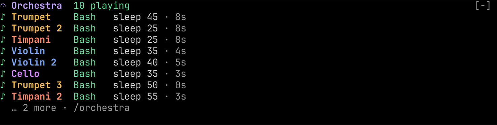

# Orchestra

A conductor agent and its musicians, inside Claude Code.

Orchestra is a Claude Code plugin. A **conductor** agent plans the work as a score, assigns parts to five **musician** subagents, runs independent parts in parallel, and presents a **coda** at the end. A Claude Code **mod** that ships in the same plugin watches the whole performance. It records every file each musician reads and writes into an append-only ledger with SHA-256 versions. It holds a write that would overwrite another musician's newer work and asks you what to do. It draws the ensemble beside your transcript.

| Musician | Subagent type | Role |
| --- | --- | --- |
| Violin | `orchestra:violin` | Scout: maps code, writes notes, never edits source |
| Trumpet | `orchestra:trumpet` | Implementer: changes source code |
| Flute | `orchestra:flute` | Scribe: writes documentation |
| Timpani | `orchestra:timpani` | Tester: runs tests and commands, saves logs |
| Cello | `orchestra:cello` | Reviewer: reports problems, never edits |

Orchestra is a picture of how agents relate and nothing more. It makes no sound and no speech, has no voice or narration feature, makes no network call, needs no API key, starts no process, and has no browser or web surface. It draws only in the Claude Code terminal (and the Desktop app's Code tab), and it redraws only when an event arrives. Versions 0.1.4 to 0.1.7 added a narrated and spoken coda and animation; 0.2.0 removed both (see [CHANGELOG.md](CHANGELOG.md)).



**[The guide](docs/guide.md)** covers installing, running a performance, every surface Orchestra draws with screenshots, colours and your theme, keys, and troubleshooting. Every screenshot is a capture from a live Claude Code 2.1.296 session; the run that produced it is recorded in [docs/verification.md](docs/verification.md#version-020).

## What it can reach

The mod runs inside Claude Code's own process with your access to files and settings; mods are not sandboxed. `claude plugin validate ./plugin` prints the same list from the code.

- **Calls:** `$.clock` (every, now), `$.command.register`, `$.config.list`, `$.env.get`, `$.fs` (exists, list, read, stat, write), `$.session.cwd`, `$.session.id`, and `$.ui` (ask, close, invalidate, log, open, resolve, status, toast). The one timer re-reads your theme every 2 seconds; it never redraws anything by itself.
- **Reach:** reads and writes files in your project. It starts no process and makes no network call.
- **Sees:** every prompt, every row added to the conversation, every subagent spawn, every tool call and its result, and the pane, the band above the prompt, the spinner, the question dialog and the Agent rows it draws into.
- **Environment:** reads `COLORTERM` and `TERM` to choose colours; sets nothing.
- **State:** nothing in `$.state` or `$.store`; the ledger is kept in files.

Threat model:

1. **Reads:** during a performance, the project files the ledger tracks (hashed before and after tool calls); its own ledger under `.orchestra/performances/`; the `theme` setting; `COLORTERM` and `TERM`.
2. **Runs:** nothing. Orchestra has no child process.
3. **Sends:** nothing. Orchestra has no network access of its own and adds no account or key.
4. **Persists:** in the session's working directory, during a performance: ledger segments `.orchestra/performances/<session>.NNNN.jsonl`, `<session>-coda.md`, and `.orchestra/.gitignore` (`*`). They stay until you delete them.
5. **Hostile input:** a file or tool result only changes the hashes recorded, never anything run. A task notification quoted in a tool result or a pasted prompt is ignored; only one Claude Code itself delivers is acted on. A ledger is replayed only if its name starts with the current session id, and a malformed one is neither used nor overwritten. Text written by the model reaches the conflict dialog only as a part summary cut to 40 characters.

## Install

Requires Claude Code **2.1.287 or later**, the version that added mods. Tested with **2.1.296**. Mods must be allowed on your machine: they are on by default, but managed settings such as `allowManagedModsOnly`, or `--bare` and `--safe-mode`, turn them off.

```sh
claude plugin marketplace add krzemienski/orchestra-cc
claude plugin install orchestra@orchestra-cc
```

To try it without installing, clone this repository and load the plugin directory for one session:

```sh
git clone https://github.com/krzemienski/orchestra-cc
claude --plugin-dir ./orchestra-cc/plugin --agent orchestra:conductor
```

Upgrading from 0.1.x: the five options `narrateCoda`, `voiceCoda`, `voiceId`, `voiceLanguage` and `voiceModel` and the `/orchestra voice` command no longer exist. Settings that name them are ignored.

## Use

Start a session with the conductor as the main agent, then describe the work:

```sh
claude --agent orchestra:conductor
```

Installing the plugin does not change your other sessions' main agent. The mod records any session where subagents run, but the conductor only conducts when you start it.

| Command | What it does |
| --- | --- |
| `/orchestra` | Opens the Orchestra pane (tabs: Ensemble, Score, Artifacts, Coda) |
| `/orchestra coda` | Prints the coda for this session from the ledger |
| `/orchestra ledger` | Prints the ledger's path, event count and status |
| `/orchestra close` | Closes the pane |

Any other argument gets `Unknown argument: <arg>. Use coda, ledger or close.` and the pane stays shut; `/orchestra voice` answers `orchestra: Unknown argument: voice. Use coda, ledger or close.` (step-59), and the plugin has no options at all (P0-21).

## What you see

Each surface below was captured live in run `e2e-evidence/run-20261013T184754-v020-live` (Claude Code 2.1.296, a clean config, ten parts started in one message). The captures are local to the build machine; [docs/verification.md](docs/verification.md#version-020) quotes them.

- **Ten at once, each by name (P0-12).** The same instrument can play several parts; the second is `Trumpet 2`, the third `Trumpet 3`. A musician keeps its name on every surface for the whole session, and a replayed ledger gives the same names. The ten-part run showed `Trumpet, Trumpet 2, Timpani, Violin, Violin 2, Cello, Trumpet 3, Timpani 2, Flute, Flute 2` with zero `Guest` and no name cut short (step-27).
- **What each musician is doing now (P0-13).** Every row's second line is `└ <tool> <target> [from vN] · <elapsed>` while it plays, `done · N measures · N reads · N writes · <time>` when it finishes, and `failed · <first error line>` when it fails, for example `└ failed · Bash ls config/missing.json: Exit code 1: ls: config/miss…` (step-20, f0016). In the ten-part run every playing row matched the ledger's open call within one redraw, 213 of 213 rows over 35 frames (step-25).
- **Agent rows (P0-14).** On Claude Code 2.1.296, parts started together run as background agents, and Claude Code draws one `⏺ N background agents launched` block for them, not an Agent row per part, so there is no row for Orchestra to label. The same second line is drawn on the band and in the Ensemble tab instead. An Agent row the engine does draw for one part gets `<Name> · <Role>` over that line.
- **The band above the prompt (P0-15).** Line 1 is the rollup: `𝄐 Orchestra  N playing · N waiting on you · N done · N failed`, then `‼ N conflict` and `⚠ N stale` while any are open; zero counts are left out. Below it, one row per musician not yet done, in the order parts were assigned: glyph, name, tool, target, elapsed. Rows past the room Claude Code gives the band fold into `… N more · /orchestra`; with a single row, the fold joins line 1: `𝄐 Orchestra  1 playing · 8 done · 1 failed · ⚠ 6 stale · … 2 more · /orchestra` (step-43, 100×20). Only the free text is ever cut, with `…`.
- **The pane.** It opens by itself on the first part, beside the transcript in a wide terminal, above the prompt in a narrow one. Keys 1–4 switch tabs.
  - **Ensemble (P0-16):** the rollup, the newest handoff (`Violin → Trumpet 2 · config/limits.json v1`), then every musician, conductor first, as `<glyph> <Name>  <Role> · <state>` over `└ <what it is doing>`, with `N measures · N reads · N writes` and `⚠ stale read` while open. Tab to a name and press Enter for its details: the part brief, every version it has seen (`config/limits.json v0 (now v1)`), its reads and writes with versions, its last calls with times, its answer, and `full transcript: ← in Claude Code's agent view` (step-34).
  - **Score:** one staff per musician over the newest ledger events (`◆ ○ ● ← · ✓ ✕ ‼ ⚠ ?`), with the legend. It is a still picture of the record.
  - **Artifacts:** every file touched, with its versions; Enter shows each version's author, base version, line delta and SHA-256, who read which version, and its conflicts.
  - **Coda:** who contributed what, artifacts changed, handoffs, conflicts, failures and stale reads, all from the ledger.
  - **Key hints (P0-17):** the pane's last row lists the keys of the tab you are on, for example `1-4 tabs · tab select · enter details · ↑↓ scroll · esc close` on Ensemble and `1-4 tabs · ↑↓ scroll · esc close` on Score (step-32).
- **The outcome line (P0-18).** When the conductor's turn ends, one transcript line with the coda's own counts: `𝄐 Coda · 10 musicians · 5 files · 1 conflict · 1 failed · 1m 31s · /orchestra coda` (step-22), which matches the coda file's contributors, artifacts, conflicts and failures.
- **Nothing moves by itself (P0-19).** Orchestra has no animation and no frame timer. Rows redraw when the ledger records an event from the conductor or a musician, and elapsed times are measured at that event, so they advance only when something happens. With one musician silent in `sleep 90` and a conflict question open, every row Orchestra drew was identical across 30 captures taken 2 s apart (step-51). Claude Code's own spinner keeps moving.
- **Colours follow your theme (P0-20).** See [Colours](docs/guide.md#5-colours-and-your-theme): a dark, light or 256-colour terminal gets colours measured at 4.5:1 or better against that background; an ANSI terminal gets its own 16 colours; an unknown theme gets no painted background at all.
- **The status line** under the prompt carries the same counts: `Orchestra · 9 done · 1 failed · 5 artifacts changed · 6 stale`.
- **Toasts** when a musician joins and rests, for handoffs (`Orchestra · handoff: Timpani read .orchestra/notes/map.md v0 from Violin`), stale reads, failures, each decided conflict, and when the coda is ready.
- **The spinner** names who is playing what: `10 playing: Trumpet Bash sleep 45 · 5s · Trumpet 2 Bash sleep 25 · 5s +8`.

## Data model

Everything Orchestra shows is folded from one append-only ledger per session in `.orchestra/performances/` in your project, written in segments of 500 events (`<session-id>.0001.jsonl`, …) so a crash can lose at most part of the newest segment. Orchestra also writes `.orchestra/.gitignore` so none of it is committed by accident.

Only observations are recorded:

| Event | Recorded when |
| --- | --- |
| `part.assigned` | The conductor's Agent call started a subagent. Carries the subagent's id, type, description and prompt. |
| `tool.call`, `tool.result` | A musician called a tool, and how it ended |
| `artifact.read` | A musician read a file. Carries the file's SHA-256 at that moment. |
| `write.attempt` | A write is about to run. Carries the SHA-256 of the file it is about to change. |
| `artifact.write` | The write landed. Carries the new SHA-256 and lines added and removed. |
| `conflict.resolved` | Your decision on a conflict |
| `part.done`, `part.failed` | The subagent's turn ended |
| `coda` | The coda file was written |

Everything else is **derived** from versions, never declared by the agents:

- **Conflict**: a musician tries to write a file whose current version is not the one it last saw. Example: Trumpet read v0, Trumpet 2 wrote v1, and Trumpet now edits from v0. Orchestra holds the write and asks in Claude Code's own question dialog: *Let it write*, *Send it back to re-read*, or *Show both versions*, which draws the lines the other musician added and the held change directly above the question before asking again. Sending it back denies the edit and tells the musician to re-read and reapply its change. In a `claude -p` run nobody can answer, so the write is sent back.
- **Stale read**: a musician produced other work after reading a version that someone has since replaced. It clears when that musician reads the current version. Revising the conductor's plan, `.orchestra/score.md`, never makes work stale.
- **Handoff**: a musician read a version that another musician wrote.
- **Coda**: written to `.orchestra/performances/<session-id>-coda.md` at the end of each conductor turn, from the ledger alone.

## Design prototype (history)

`prototype/` is the approved Stage 2 design artifact, frozen as it was approved. It is not a product surface, it is not used to verify the plugin, and nothing in `plugin/` loads it.

## Research

- `docs/orchestra-research-report.md` covers Claude Code plugins, mods and modes; prior art; OpenCode, Pi and terminal UX with visual evidence; data-operation patterns; and open questions. Every claim is labelled and linked.
- `docs/orchestra-prototype-design.md` gives the design rationale for the prototype.
- `docs/PRD-orchestra.md` is the product requirements document (PRD v2) that 0.2.0 implements; `docs/plan-0.2.0.md` is its build plan.
- `docs/orchestra-prd.md` is the original approved build spec, superseded by PRD v2 and kept for its line citations.
- `docs/orchestra-spec.md` is the engineering specification: event flow, derivation rules and the verification plan.
- `docs/tui-research.md` is the study of omp, OpenCode, Amp and Claude Code that the 0.2.0 interaction design follows.
- `docs/verification.md` records how the plugin was verified in a real environment, screen by screen.

## Limitations

- Mod drawing appears only in the Claude Code terminal and the Desktop app's Code tab. In the VS Code extension, `claude -p` and cloud sessions, the ledger, conflict guard and coda still work, but nothing is drawn.
- **Agent rows for parts started together.** Claude Code 2.1.296 runs them as background agents and draws one summary block, so they carry no per-part label; the band and the Ensemble tab carry each musician's line instead.
- **A small terminal.** While Claude Code lists its running agents, it gives the band no rows at all at 100×20, so the band is hidden until the list shrinks; the status line under the prompt keeps the counts. At 160×48 the band gets about ten rows and folds the rest into `… N more · /orchestra`.
- **ANSI themes on a truecolor terminal.** In an ANSI theme Orchestra hands Claude Code colour names (`yellow`), and Claude Code itself draws names as 24-bit colours when the terminal supports them. A terminal without truecolor or 256 colours gets 16-colour codes throughout.
- Elapsed times are measured at the newest recorded event, so during a long silent call they hold still until something happens. Claude Code's own agent list shows a live elapsed time.
- A change a musician makes with Bash (for example `sed -i`) to a file Orchestra already tracks is credited to that musician, marked "via Bash", and marked uncertain if another musician ran a tool that can change files at the same time, or had a command running in the background. Files created by Bash are not recorded, so the musicians are told to create files with Write and Edit.
- A command that hides its own exit code (for example `npm test; echo $?`) is recorded as a success. The tester and conductor are instructed never to append anything to a command, but a model can still ignore that.
- If one of Orchestra's own hooks fails, Claude Code skips it and the work goes on (fail open). `claude plugin validate` reports this as `gating hook without .catch` for `session.append`, `config.set`, `prompt.submit`, `agent.spawn` and `ui.scroll`. The exception is a write Orchestra could not check against the other musicians' work in time: the `tool.call` hook's `.catch` sends it back to be read again and retried, so it never lands unchecked.
- Progress is counted in measures (completed tool calls), not as a fraction of a known total, because Claude Code exposes no step plan for a subagent.
- Hot reload of the mod waits until the current turn ends. After a reload, or after `claude --continue`, the session's ledger is replayed, so the picture is rebuilt rather than lost.
- The mods API is new: it was added in 2.1.287, and the events and methods may change between releases. This version was last tested against 2.1.296.
- Agent teams (split-pane teammates in separate processes) were not tested.

## License

MIT
