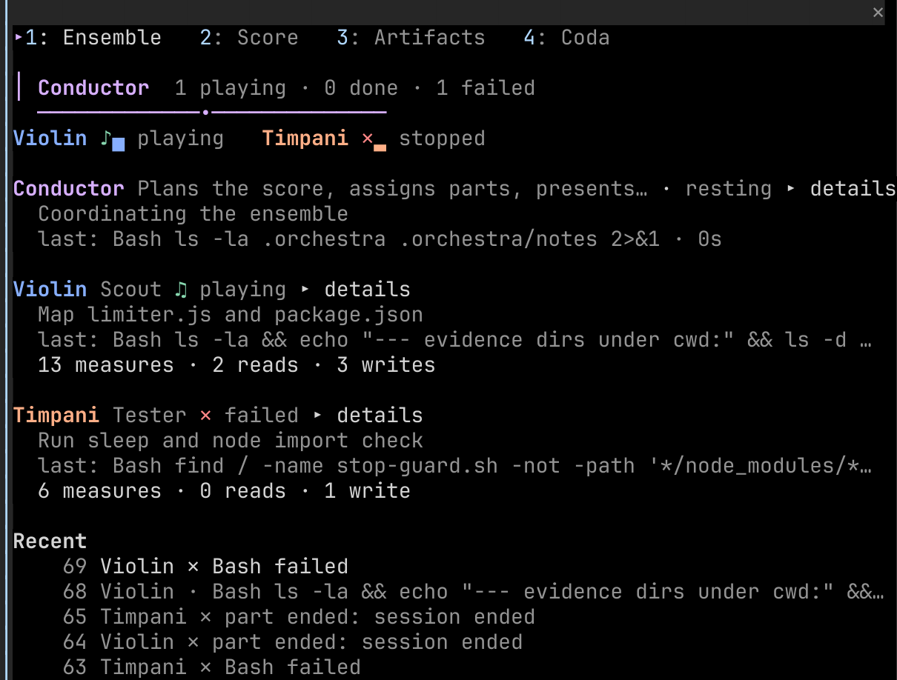
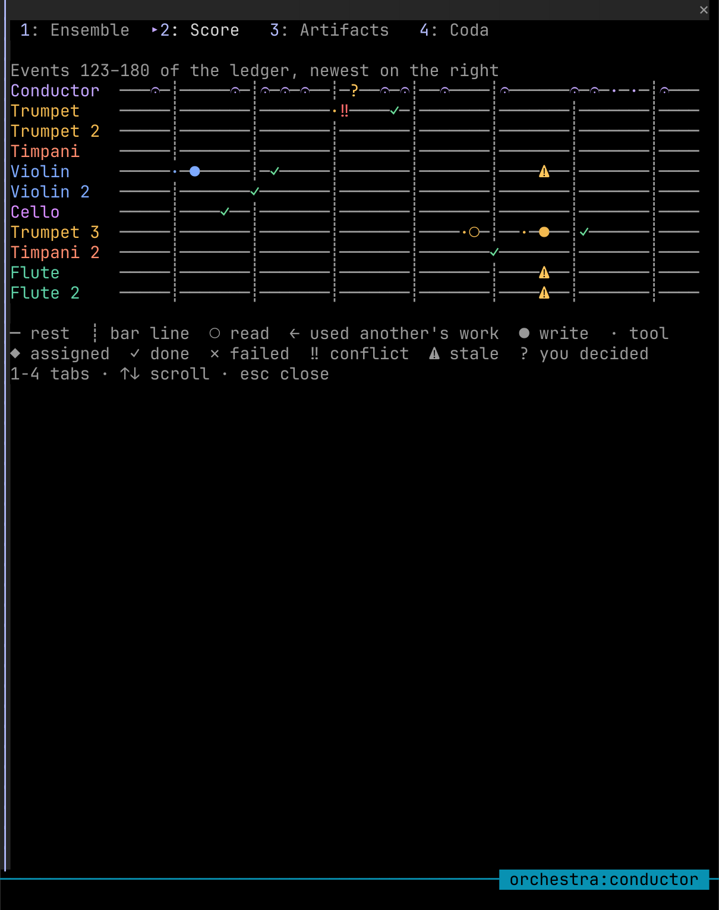
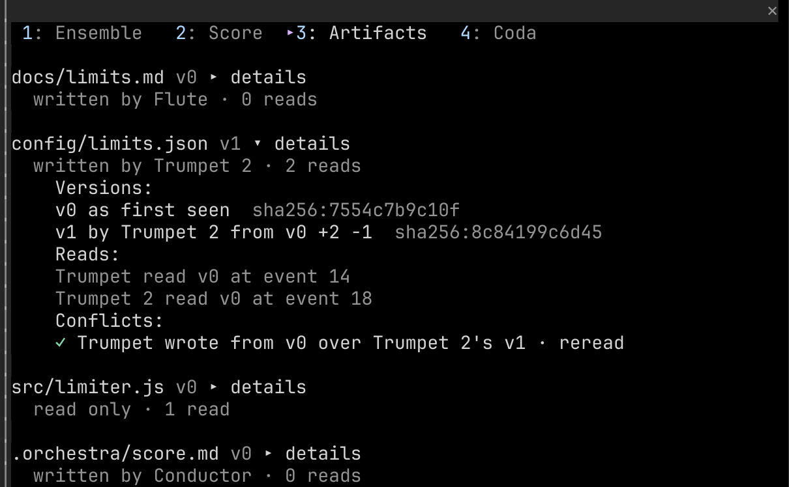
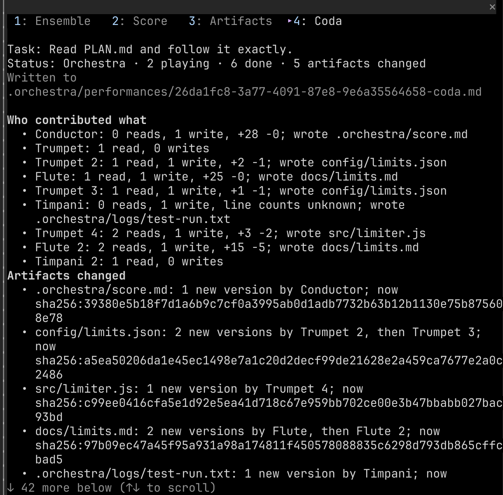
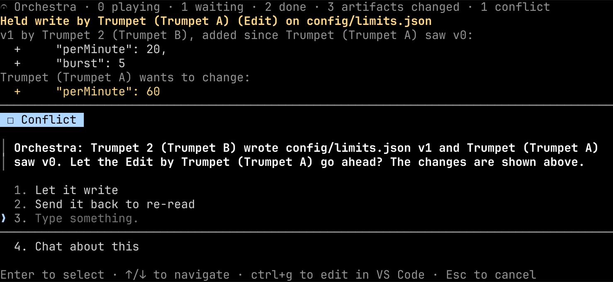
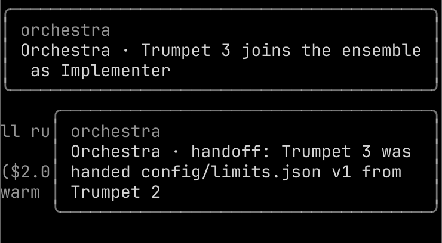
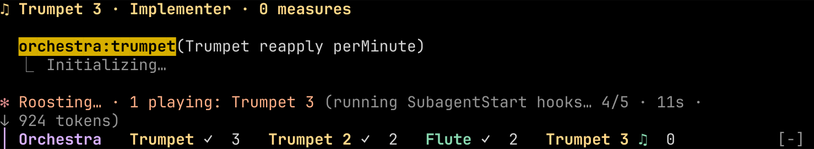
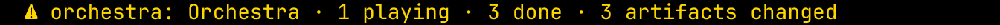

# Orchestra guide: install, use, and what you see

This guide covers installing Orchestra, running a performance, and reading every surface it draws. The screenshots come from a real session: Claude Code 2.1.296 in tmux, this repository's plugin, three musicians. They were rendered cell for cell from `tmux capture-pane -e`, with the colours the terminal received.

- [1. Requirements](#1-requirements)
- [2. Install](#2-install)
- [3. Run a performance](#3-run-a-performance)
- [4. What you see](#4-what-you-see)
- [5. Colours and your theme](#5-colours-and-your-theme)
- [6. Commands and keys](#6-commands-and-keys)
- [7. Optional: narrated and spoken coda](#7-optional-narrated-and-spoken-coda)
- [8. Files Orchestra writes](#8-files-orchestra-writes)
- [9. Troubleshooting](#9-troubleshooting)

## 1. Requirements

| Need | Why |
| --- | --- |
| Claude Code 2.1.287 or later (tested on 2.1.296) | Mods, the part of the plugin that records and draws, arrived in 2.1.287 |
| Mods allowed | On by default. Managed settings such as `allowManagedModsOnly`, and `--bare` or `--safe-mode`, turn them off |
| The interactive terminal or the Desktop app's Code tab | The only places mods draw. Under `claude -p`, in the VS Code extension and in cloud sessions, the ledger, conflict guard and coda still work, but nothing is drawn |
| A wide terminal for the side pane | In a wide fullscreen terminal the pane docks beside the transcript; otherwise it is a framed region above the prompt. The pane Orchestra opens by itself when the first musician starts appears only from 144 columns (110 once you have opened it yourself); `/orchestra` opens it at any width |

## 2. Install

From the published marketplace:

```sh
claude plugin marketplace add krzemienski/orchestra-cc
claude plugin install orchestra@orchestra-cc
```

Or load a checkout for one session, without installing:

```sh
git clone https://github.com/krzemienski/orchestra-cc
claude --plugin-dir ./orchestra-cc/plugin --agent orchestra:conductor
```

To check the plugin before you use it:

```sh
claude plugin validate ./orchestra-cc/plugin    # ✔ Validation passed
claude plugin test ./orchestra-cc/plugin        # 3 pass, 0 fail
```

`validate` also lists what the mod can reach: the calls it makes, the environment variables it reads (`COLORTERM`, `TERM`) and that it writes none.

## 3. Run a performance

Start Claude Code with the conductor as the main agent:

```sh
claude --agent orchestra:conductor
```

Then describe the work, for example:

> Use the violin to map src/limiter.js and package.json into .orchestra/notes/map.md, then have the flute write NOTES.md from those notes and the timpani run the import check.

The conductor writes its plan to `.orchestra/score.md`, assigns parts to the musicians, and runs independent parts in parallel. When the first musician starts, Orchestra opens its pane (in a terminal of at least 144 columns; in a narrower one, type `/orchestra`). When every part is settled, the conductor gives the coda and Orchestra writes its own coda from the ledger.

| Musician | Subagent | Plays |
| --- | --- | --- |
| Violin | `orchestra:violin` | Scout: reads and maps code, writes notes, never edits source |
| Trumpet | `orchestra:trumpet` | Implementer: changes source |
| Flute | `orchestra:flute` | Scribe: writes documentation |
| Timpani | `orchestra:timpani` | Tester: runs commands, saves logs |
| Cello | `orchestra:cello` | Reviewer: reports problems, never edits |

Installing Orchestra does not change the main agent of your other sessions. The mod records any session where subagents run, but the conductor only conducts when you start it.

## 4. What you see

Everything Orchestra draws comes from its ledger: the files each musician read and wrote, with their hashes, and the tool calls it made. Nothing comes from what a model says about its own work. Motion runs on a 250 ms frame timer, which runs only while a musician is playing or waiting in an interactive session. An idle session never redraws.

### The band above the prompt


- The conductor's baton beats (`╲ │ ╱ │`) while anyone plays, and rests as `𝄐` when nobody does.
- Each musician has a coloured name, its state mark, an activity bar and its measures (completed tool calls). The mark is a cycling note `♩ ♪ ♫ ♬` while it plays, a blinking `‖` while it waits on you, `✓` when it is done and `✕` when it stopped. The bar `▁` to `█` counts its tool calls among the last 20 events. A tool running now is named after the count.
- Open conflicts (`‼`) and stale reads (`⚠`) are counted at the end.

### The pane: Ensemble



From the top:

1. **Tabs**: `1: Ensemble  2: Score  3: Artifacts  4: Coda`. Click one, or focus the pane (Ctrl+X then Tab) and press its number.
2. **The stage**: the conductor's line, with how many musicians are playing, done and failed. For 1.5 s after the conductor assigns a part it adds `cue → Trumpet`. Under it, a pulse runs down the line to the section.
3. **The section**: one chair per musician. A chair reads `playing`, `waiting on you`, `resting` (done) or `stopped` (failed). For the second after the ledger records a change it steps through the change: `· ♩ ♪ ♫ joining`, `♪ ♩ · resting`, or `♪ ✕ stopping`.
4. **The handoff**, when one happened in the last 12 events: an arrow carries the file from the musician who wrote it to the one who took it, for example `Violin ━━━▶ Flute  .orchestra/notes/map.md v0`.
5. **Seats**: each musician's name, role, mark, state and a `▸ details` button. Under it is the open tool call with its target and running time (`Bash npm test · 4s`). Between calls it shows the last finished call and how long it took (`last: Edit src/limiter.ts · 2s`). Then measures, reads and writes, and `⚠ stale read` if its work is out of date. `▸ details` adds the musician's part, every file version it has seen, and its answer.
6. **Recent**: the six newest ledger events in words, newest first. Finished calls carry their duration.

### The pane: Score



One staff per musician, with the newest event on the right. The header says where the performance is: `bar 6, beat 2`. The bar comes from the ledger (eight events to a bar), and the beat advances 1 to 4 with the frame timer. On a staff:

| Mark | Means |
| --- | --- |
| `─` | A rest: another musician's event |
| `┊` | A bar line, every 8 events |
| `◆` | A part assigned |
| `·` | A tool call |
| `○` / `←` | A read / a read of another musician's work (a handoff) |
| `●` | A write |
| `♪━━━` | A held note: the open tool call, growing one bar per second |
| `│` `┃` | The playhead, pulsing on a playing musician's staff |
| `✓` `✕` | Done / failed |
| `‼` `⚠` `?` | A conflict / a stale read / a decision you made |

### The pane: Artifacts



Every file the musicians touched, newest first, with its current version and who wrote it. Select `▸ details` to see each version's author, base version, line delta and SHA-256, who read which version and at which ledger event, and any conflicts on it with your decision. Above, two trumpets read `config/limits.json` at v0; Trumpet 2 wrote v1 first, so Trumpet's edit from v0 was a conflict, and it was sent back to re-read.

### The pane: Coda



Computed from the ledger alone: the task, the status line, who contributed what, which artifacts changed (with their current SHA-256), handoffs, conflicts with your decisions, failures, stale reads and background commands. It is also written to `.orchestra/performances/<session>-coda.md`. If the spoken coda is on, its result follows under **Spoken by ElevenLabs**.

### Conflicts: the question dialog



When a musician is about to overwrite a newer version than the one it saw, Orchestra holds the write and asks you in Claude Code's own question dialog. *Let it write* lets it land; *Send it back to re-read* denies it and tells the musician to read the file again and reapply its change; *Show both versions* (the state above) draws, above the question, the lines the other musician added since this one's version and the change this one wants to make, then asks again. In a `claude -p` run nobody can answer, so the write is sent back.

### Toasts



In the top right of the transcript: when a musician joins (with its role) and rests (with its measures, reads and writes), when a tool call that ran 3 s or more finishes (`Timpani finished Bash npm test · 12s`), and for handoffs, stale reads, failures, decided conflicts and a ready coda.

### Agent rows, spinner and band



- **Agent rows** in the transcript carry a line above Claude Code's own: the musician's mark, name, role and measures, in its colour. When several parts start in one message, Claude Code draws one summary row a mod cannot redraw, so those are not labelled.
- **The spinner** names who is playing what, on which file, for how long, what a musician between calls last finished, and who is waiting on you: `· 1 playing: Trumpet 3`, or `· 2 playing: Trumpet Edit limiter.js · 4s · Flute after Read (1s)`.
- **The band** sits under it, as described above.

### Status line



Under the prompt: `Orchestra · 1 playing · 3 done · 3 artifacts changed`, with failures, conflicts and stale reads added when there are any.

## 5. Colours and your theme

Orchestra follows your terminal, not a palette of its own.

- **The band, status line, spinner and toasts** paint no background. They sit on the terminal's own background, whatever it is.
- **The pane** is the one exception. Claude Code fills a docked pane with its own grey (xterm 235, `#262626`), which made the pane a different colour from the rest of the screen. Orchestra paints the pane body with the background its colours were measured on, so the inside matches the terminal around it: black on a dark terminal, white on a light one. Under an ANSI theme, Claude Code's own fill is left alone (see the last row of the table). The divider and close mark on the pane's frame still belong to Claude Code.
- **Instrument colours** are chosen for contrast, each at least 4.5:1 against that background. The lowest are 7.57 on black, 5.32 on white, and 5.77 for the exact 256-colour value sent.

Which colours you get depends on your Claude Code theme (`/theme`) and on what the terminal says it supports:

| Your setup | Colours | Pane ground |
| --- | --- | --- |
| Dark theme, `COLORTERM=truecolor` (or `24bit`) | Hex values measured on black | Black |
| Light theme, `COLORTERM=truecolor` | Hex values measured on white | White |
| `TERM` contains `256`, no truecolor | The nearest xterm-256 entry, sent so Claude Code's renderer lands on that exact entry | Black |
| An ANSI theme (`dark-ansi`, `light-ansi`), or none of the above | The terminal's own 16 colours | Claude Code's own (it is mapped through your terminal palette) |

A change of theme is picked up within 2 seconds. To check what your terminal says, run `echo $COLORTERM $TERM`. In tmux, `COLORTERM` is set to `truecolor` inside panes.

## 6. Commands and keys

| Command | What it does |
| --- | --- |
| `/orchestra` | Opens the pane |
| `/orchestra coda` | Prints the coda for this session |
| `/orchestra ledger` | Prints the ledger's path, event count and status |
| `/orchestra voice` | Reads the coda aloud with ElevenLabs (see below) |
| `/orchestra close` | Closes the pane |

| Key | In the pane |
| --- | --- |
| Ctrl+X, then Tab | Moves focus into the pane (the prompt must be empty) |
| Ctrl+X, then X | Closes the pane even while focus is elsewhere |
| Ctrl+X, then an arrow | Resizes the pane |
| `1` `2` `3` `4` | Switches tab while the pane has focus |
| Tab, ↑ ↓, Enter | Moves between and presses buttons (`▸ details`) |
| ↑ ↓ and Claude Code's page and Home/End keys | Scrolls the tab under its fixed tab row |
| Esc | Closes the pane |

The mouse works too: click a tab or a button.

## 7. Optional: narrated and spoken coda

Both are off by default and set in `/config`, under Orchestra's options.

- **Narrate the coda** (`narrateCoda`): Claude retells the coda as prose, in a second file beside it. It needs `npm install --prefix <plugin directory>/narrate` once, and makes one Claude call per narration with your login.
- **Speak the coda** (`voiceCoda`): ElevenLabs reads the narration, or the coda, into `<session>-coda.mp3`. It needs your ElevenLabs API key in `ELEVENLABS_API_KEY` and a voice id. Step-by-step setup, the voice and language choice, models and costs are in [asset-handout.md](asset-handout.md).

The mod itself makes no network call. Both helpers run as separate processes on fixed command lines, with their input on standard input.

## 8. Files Orchestra writes

All files go in the project where the performance runs, under `.orchestra/`, which Orchestra gitignores (`.orchestra/.gitignore` holds `*`):

| File | What |
| --- | --- |
| `.orchestra/score.md` | The conductor's plan |
| `.orchestra/performances/<session>.0001.jsonl` … | The ledger, in segments of 500 events |
| `.orchestra/performances/<session>-coda.md` | The coda, from the ledger |
| `.orchestra/performances/<session>-coda-narrated.md` | Claude's retelling, if narration is on |
| `.orchestra/performances/<session>-coda.mp3` | The spoken coda, if voice is on |

The musicians may also write notes and logs under `.orchestra/notes/` and `.orchestra/logs/`. Those are their work, recorded like any other file.

## 9. Troubleshooting

| You see | Do |
| --- | --- |
| No pane, no band | The session has no performance yet: one starts when the conductor assigns a part. Check that mods are allowed, and that you are in the interactive terminal or the Desktop app. If the band shows but the pane does not, the terminal is under 144 columns: type `/orchestra` |
| The pane opens above the prompt, not beside it | The terminal is not wide enough or not in fullscreen for a docked pane. Widen it, or resize the pane with Ctrl+X then an arrow |
| Colours look wrong or flat | Run `echo $COLORTERM $TERM`, and see the table in [section 5](#5-colours-and-your-theme). An ANSI theme uses your terminal's 16 colours |
| Pressing `2` types into the prompt | The pane does not have focus. Empty the prompt, press Ctrl+X then Tab, or click the tab |
| A musician's write was "sent back" | It tried to overwrite a newer version than the one it read. It re-reads the file and reapplies its change; the coda records it |
| `/orchestra voice` says the key is not set | Set `ELEVENLABS_API_KEY` in the shell you start Claude Code from, then restart it (see [asset-handout.md](asset-handout.md)) |
| An edit to the mod does nothing | With `--plugin-dir`, the mod reloads at the end of the current turn. The ledger is replayed, so nothing is lost |
