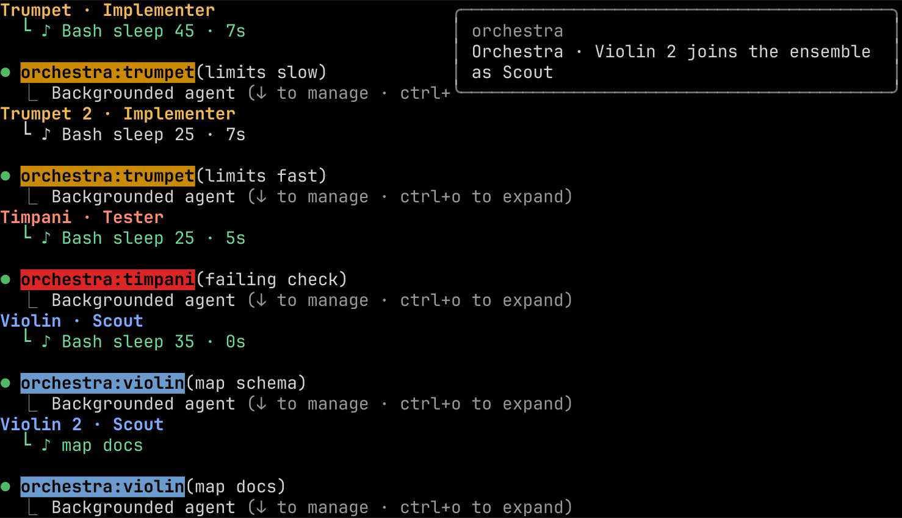
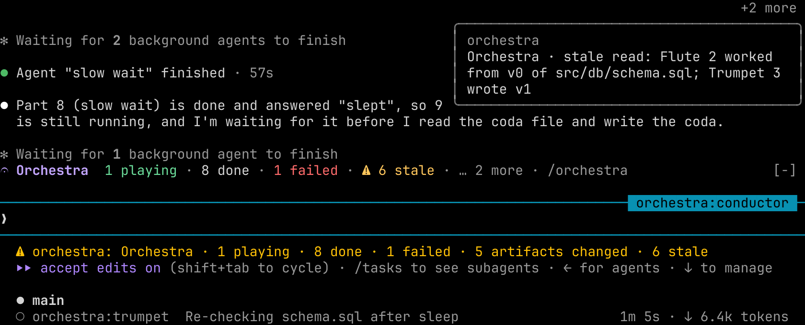
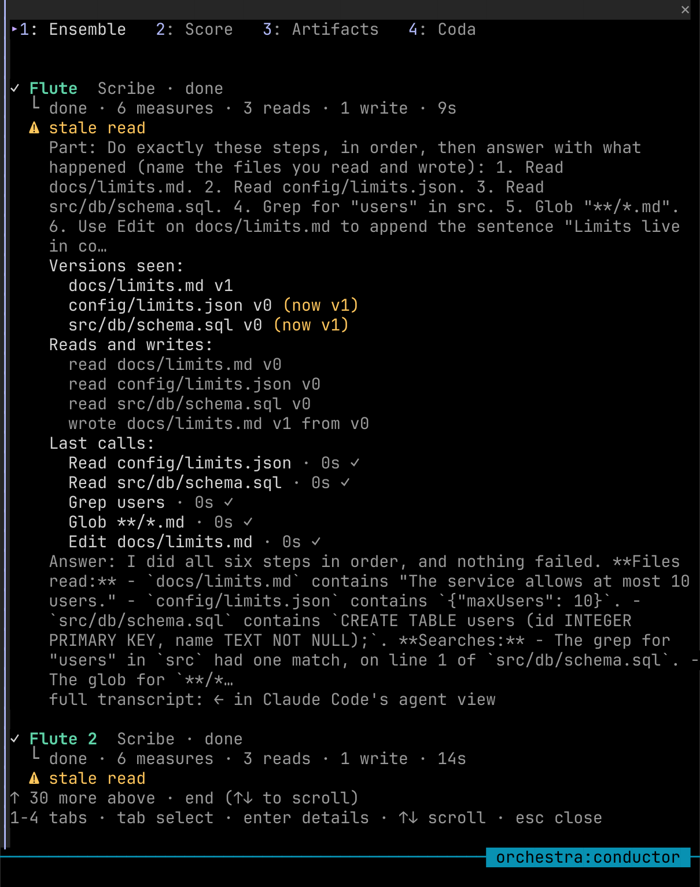
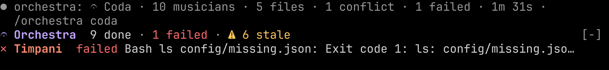
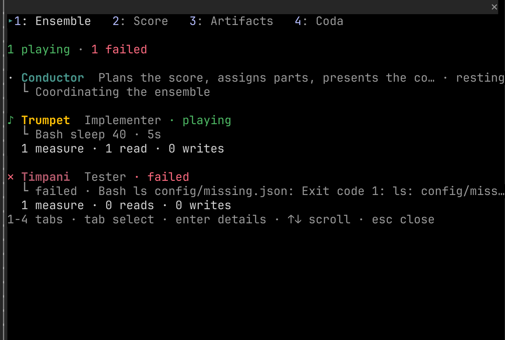

# Orchestra guide: install, use, and what you see

This guide covers installing Orchestra, running a performance, and reading every surface it draws. The screenshots come from the 0.2.0 verification run `e2e-evidence/run-20261013T184754-v020-live`: Claude Code 2.1.296 in tmux, a clean config, this repository's plugin, ten musicians started in one message. They were rendered cell for cell from `tmux capture-pane -e`, with the colours the terminal received. [docs/verification.md](verification.md#version-020) quotes each capture.

Orchestra is a picture of how agents relate. It has no sound, speech, voice or narration feature, makes no network call, needs no key, starts no process, and has no browser or web surface. Nothing in it animates: it redraws when an event arrives.

- [1. Requirements](#1-requirements)
- [2. Install](#2-install)
- [3. Run a performance](#3-run-a-performance)
- [4. What you see](#4-what-you-see)
- [5. Colours and your theme](#5-colours-and-your-theme)
- [6. Commands and keys](#6-commands-and-keys)
- [7. Files Orchestra writes](#7-files-orchestra-writes)
- [8. Troubleshooting](#8-troubleshooting)

## 1. Requirements

| Need | Why |
| --- | --- |
| Claude Code 2.1.287 or later (tested on 2.1.296) | Mods, the part of the plugin that records and draws, arrived in 2.1.287 |
| Mods allowed | On by default. Managed settings such as `allowManagedModsOnly`, and `--bare` or `--safe-mode`, turn them off |
| The interactive terminal or the Desktop app's Code tab | The only places mods draw. Under `claude -p`, in the VS Code extension and in cloud sessions, the ledger, conflict guard and coda still work, but nothing is drawn |
| A wide terminal for the side pane | In a wide fullscreen terminal the pane docks beside the transcript; otherwise it is a framed region above the prompt. The pane Orchestra opens by itself when the first musician starts appears only from 144 columns (110 once you have opened it yourself); `/orchestra` opens it at any width |

## 2. Install

From the published marketplace:

```sh
claude plugin marketplace add krzemienski/orchestra-cc
claude plugin install orchestra@orchestra-cc
```

Or load a checkout for one session, without installing:

```sh
git clone https://github.com/krzemienski/orchestra-cc
claude --plugin-dir ./orchestra-cc/plugin --agent orchestra:conductor
```

To check the plugin before you use it:

```sh
claude plugin validate ./orchestra-cc/plugin    # ✔ Validation passed
claude plugin test ./orchestra-cc/plugin        # 10 pass, 0 fail
```

`validate` also lists what the mod can reach: the calls it makes, the environment variables it reads (`COLORTERM`, `TERM`) and that it writes none.

## 3. Run a performance

Start Claude Code with the conductor as the main agent:

```sh
claude --agent orchestra:conductor
```

Then describe the work, for example:

> Use the violin to map src/limiter.js and package.json into .orchestra/notes/map.md, then have the flute write NOTES.md from those notes and the timpani run the import check.

The conductor writes its plan to `.orchestra/score.md`, assigns parts to the musicians, and runs independent parts in parallel. When the first musician starts, Orchestra opens its pane (in a terminal of at least 144 columns; in a narrower one, type `/orchestra`). When every part is settled, the conductor gives the coda and Orchestra writes its own coda from the ledger.

| Musician | Subagent | Plays |
| --- | --- | --- |
| Violin | `orchestra:violin` | Scout: reads and maps code, writes notes, never edits source |
| Trumpet | `orchestra:trumpet` | Implementer: changes source |
| Flute | `orchestra:flute` | Scribe: writes documentation |
| Timpani | `orchestra:timpani` | Tester: runs commands, saves logs |
| Cello | `orchestra:cello` | Reviewer: reports problems, never edits |

Installing Orchestra does not change the main agent of your other sessions. The mod records any session where subagents run, but the conductor only conducts when you start it.

## 4. What you see

Everything Orchestra draws comes from its ledger: the files each musician read and wrote, with their hashes, and the tool calls it made. Nothing comes from what a model says about its own work.

Every surface describes a musician the same way, in the same columns: its state glyph, its name, what it is doing now, and for how long.

| Glyph | Word | Colour |
| --- | --- | --- |
| `·` | resting | none |
| `♪` | playing | green |
| `‖` | waiting on you | amber |
| `✓` | done | none |
| `✕` | failed | red |
| `‼` | conflict | red, bold |
| `⚠` | stale | amber |

### Names: ten at once (P0-12)

The same instrument can play several parts at once. The first is `Trumpet`, the second `Trumpet 2`, the third `Trumpet 3`, in the order the conductor assigned them, and a musician keeps its name on every surface for the whole session. In the ten-part run the names were `Trumpet, Trumpet 2, Timpani, Violin, Violin 2, Cello, Trumpet 3, Timpani 2, Flute, Flute 2`, each found on the band, the Ensemble tab and its toasts, with zero `Guest` and no name cut short (capture step-27). Names, not colours, tell musicians apart: there are only six instrument colours.

### What each musician is doing now (P0-13)

Each musician's second line says what it is doing:

- while it plays: `└ <tool> <target> [from vN] · <elapsed>`, for example `└ Bash sleep 45 · 8s`, or `└ Edit config/limits.json from v0 · 2s` for a write, naming the version it is writing from;
- between calls: its part brief;
- when it is held: `└ held config/limits.json: Trumpet 2 wrote v1 since you read v0`;
- when done: `└ done · 3 measures · 1 read · 1 write · 39s`;
- when failed: `└ failed · Bash ls config/missing.json: Exit code 1: ls: config/miss…`, the first line of the error.

Elapsed time runs from the start of the call to the newest event the ledger recorded, so it moves when something happens, not on a clock. In the ten-part run, every playing musician's line matched the ledger's open call within one redraw: 213 of 213 rows over 35 captures taken 3 s apart (step-25).

### Agent rows (P0-14)



Every part has its own Agent row in the transcript, and Orchestra draws two lines above Claude Code's own: `<Name> · <Role>`, then the same second line the band shows, for example `Trumpet · Implementer` over `└ ♪ Bash sleep 45 · 7s`. The line is redrawn as the part goes on, and ends as `└ ✓ done · 6 measures · 3 reads · 1 write · 9s` (fix2 run, step-18).

Claude Code draws several Agent calls made in one message as one block (`⏺ 3 background agents launched`, or `⏺ Running 3 agents…` when fork mode is off) and does not draw what a mod returns for them (W0 run, step-24; fix2 run, probes). In an interactive session every part runs in the background anyway, so the conductor starts each part with its own Agent call, one message after another; the parts still play at once, and each gets its own labelled row. In the ten-part run all ten rows were labelled, `Trumpet · Implementer` to `Flute 2 · Scribe`, and every playing row's second line matched the ledger (fix2 run, step-23: 251 of 251 rows across band, Ensemble and Agent rows). If you ask the conductor to start parts in one message, Claude Code groups them and the band and the Ensemble tab carry each line.

### The band above the prompt (P0-15)


- **Line 1 is the rollup:** `𝄐 Orchestra  10 playing`, or later `9 done · 1 failed · ⚠ 6 stale`. It counts playing, waiting on you, done and failed, then open conflicts (`‼ 1 conflict`) and stale reads; a zero count is left out.
- **Then one row per musician not yet done,** in the order parts were assigned: glyph, name, tool, target and elapsed time. A done musician leaves the band; a failed one stays, with its error.
- **Rows past the band's room fold** into `… 2 more · /orchestra`. Claude Code decides the room: at 160×48 the inline view showed all ten rows (step-71), and the fullscreen view (`CLAUDE_CODE_NO_FLICKER=1`), which keeps its agent list in the same bottom half, gave the band ten rows, so eight musicians and the fold (step-20). When it gives one row, the fold joins line 1:



While Claude Code lists its running agents in a short terminal it can give the band no rows at all (seen at 100×20 in the fullscreen view). Then the status line under the prompt carries the rollup and the fold instead, `orchestra: Orchestra · 2 playing · … 2 more · /orchestra`, and the row Orchestra draws above a conflict question is the band's rollup, `𝄐 Orchestra  2 playing · 1 waiting on you · 6 done · 1 failed · ‼ 1 conflict`. In the 100×20 run every frame with a musician playing showed one or the other (fix2 run, step-41: 78 of 78).

Only the free text is ever cut, with `…`. Glyph, name and time keep their columns.

### The pane: Ensemble (P0-16)


From the top: the tabs, the rollup, the newest handoff (`Violin → Trumpet 2 · config/limits.json v1`) while it is among the last 12 events, then every musician, conductor first:

```
♪ Trumpet  Implementer · playing
  └ Bash sleep 45 · 8s
  1 measure · 1 read · 0 writes
```

`⚠ stale read` is added while that musician's work is out of date. Press Tab until a name is highlighted, then Enter, for its details:



The details list the part brief, every file version it has seen (`config/limits.json v0 (now v1)`), its reads and writes with versions (`wrote docs/limits.md v1 from v0`), its last five calls with their times, its answer, and `full transcript: ← in Claude Code's agent view`. A mod cannot open a subagent's transcript; Claude Code's own agent view does.

### The pane: Score


One staff per musician, with the newest event on the right. It is a still picture of the record:

| Mark | Means |
| --- | --- |
| `─` | A rest: another musician's event |
| `┊` | A bar line, every 8 events |
| `◆` | A part assigned |
| `·` | A tool call |
| `○` / `←` | A read / a read of another musician's work (a handoff) |
| `●` | A write |
| `✓` `✕` | Done / failed |
| `‼` `⚠` `?` | A conflict / a stale read / a decision you made |

### The pane: Artifacts


Every file the musicians touched, newest first, with its current version or status. Select `▸ details` to see each version's author, base version, line delta and SHA-256, who read which version and at which ledger event, and any conflicts on it with your decision.

### The pane: Coda


Computed from the ledger alone: the task, the status line, who contributed what, which artifacts changed (with their current SHA-256), handoffs, conflicts with your decisions, failures, stale reads and background commands. The same text is in `.orchestra/performances/<session>-coda.md` and printed by `/orchestra coda`.

### Key hints (P0-17)

The pane's last row lists the keys of the tab you are on: `1-4 tabs · tab select · enter details · ↑↓ scroll · esc close` on Ensemble and Artifacts, `1-4 tabs · ↑↓ scroll · esc close` on Score and Coda. It stays the last row while a long tab scrolls (step-32).

### The outcome line (P0-18)



When the conductor's turn ends, Orchestra writes the coda file and logs one line: `𝄐 Coda · 10 musicians · 5 files · 1 conflict · 1 failed · 1m 31s · /orchestra coda`. Its counts are the coda's: the musicians who contributed, the artifacts changed, the conflicts and the failed parts. In the ten-part run the coda file listed 10 contributors, 5 artifacts, 1 conflict and 1 failure (step-22, step-23).

### Conflicts: the question dialog


When a musician is about to overwrite a newer version than the one it saw, Orchestra holds the write and asks you in Claude Code's own question dialog. *Let it write* lets it land; *Send it back to re-read* denies it and tells the musician to read the file again and reapply its change; *Show both versions* (above) draws the lines the other musician added since this one's version and the change this one wants to make, then asks again. In a `claude -p` run nobody can answer, so the write is sent back.

### Toasts


In the top right of the transcript: when a musician joins (with its role) and rests (with its measures, reads and writes), when a tool call that ran 3 s or more finishes, and for handoffs (`Orchestra · handoff: Timpani read .orchestra/notes/map.md v0 from Violin`), stale reads, failures, decided conflicts and a ready coda.

### Spinner and status line

- **The spinner** names who is playing what: `10 playing: Trumpet Bash sleep 45 · 5s · Trumpet 2 Bash sleep 25 · 5s +8`, and who is waiting on you.
- **The status line** under the prompt carries the rollup's counts with the files changed:


### Nothing moves by itself (P0-19)

Orchestra draws no animation and runs no frame timer. It redraws when the ledger records an event from the conductor or one of its musicians; events from loops it does not show (Claude Code's own background forks, another plugin's agents) are recorded but do not redraw. In the verification run, one musician sat in `sleep 90` while a conflict question was open, and every row Orchestra drew was identical across 30 captures 2 s apart (step-51); the same check on 0.1.7 found 29 of 29 captures different. Claude Code's spinner keeps moving, which is how you see that work is happening.

## 5. Colours and your theme (P0-20)

Orchestra follows your terminal, not a palette of its own.

- **The band, status line, spinner and toasts** paint no background. They sit on the terminal's own background, whatever it is.
- **The pane** is the one exception. Claude Code fills a docked pane with its own grey (`#262626`), which no plugin can clear. Orchestra paints the pane body over it with the background its colours were measured on: black on a dark terminal, white on a light one. When it cannot name your theme, it asks Claude Code for the theme's own `inverseText` colour, which is that same black or white in your real theme.


- **Colours** are chosen for contrast, each at least 4.5:1 against that background. The lowest are 7.57 on black, 5.32 on white, and 5.77 for the exact 256-colour value sent (`node .planning/contracts/palette-proof.mjs`).

Which colours you get depends on your Claude Code theme (`/theme`) and on what the terminal says it supports. Each row was captured live (step-56, step-57):

| Your setup | Colours | Pane ground | Seen in the capture |
| --- | --- | --- | --- |
| Dark theme, `COLORTERM=truecolor` | Hex values measured on black | Black | Trumpet `38;2;242;185;80`, ground `48;2;0;0;0` |
| Light theme, `COLORTERM=truecolor` | Hex values measured on white | White | Trumpet `38;2;138;90;0`, ground `48;2;255;255;255` |
| `TERM` contains `256`, no truecolor | The nearest xterm-256 entry | Black | Trumpet `38;5;215`, ground `48;5;16` |
| A terminal with neither (`TERM=xterm`) | Claude Code theme keys, drawn in 16 colours | Claude Code's own | `31 32 36 37 93 95`; no `38;` code |
| An ANSI theme (`dark-ansi`, `light-ansi`) | Claude Code theme keys (`warning`, `success`, `error`, `planMode`, `suggestion`, `merged`), which the theme draws as 16-colour codes | Claude Code's own | `91 92 93 96 37`; no `38;5;` or `38;2;` code (fix2 run, step-45) |
| A theme Orchestra cannot read or name (`auto`, `custom:<slug>`) | Claude Code theme keys, drawn as your real theme draws them, each at least 4.5:1 on black and on white | A docked pane: the theme key `inverseText`, which your theme resolves to black (dark) or white (light), so Claude Code's grey fill does not show. An inline pane: nothing | `auto`: `48;2;0;0;0`; light-based custom theme: `48;2;255;255;255`; inline: no `48;` code (pane-fill run, steps 02, 12, 23) |

A change of theme is picked up within 2 seconds. To check what your terminal says, run `echo $COLORTERM $TERM`. tmux passes 256 colours or truecolor depending on its own settings, so a capture in tmux may not show what your terminal draws directly.

## 6. Commands and keys

| Command | What it does |
| --- | --- |
| `/orchestra` | Opens the pane |
| `/orchestra coda` | Prints the coda for this session |
| `/orchestra ledger` | Prints the ledger's path, event count and status |
| `/orchestra close` | Closes the pane |

Any other argument answers `Unknown argument: <arg>. Use coda, ledger or close.` and leaves the pane shut. `/orchestra voice`, which spoke the coda in 0.1.6–0.1.7, now gets exactly that answer (step-59), and the plugin has no options (P0-21).

| Key | In the pane |
| --- | --- |
| Ctrl+X, then Tab | Moves focus into the pane (the prompt must be empty) |
| Ctrl+X, then X | Closes the pane even while focus is elsewhere |
| Ctrl+X, then an arrow | Resizes the pane |
| `1` `2` `3` `4` | Switches tab while the pane has focus |
| Tab, Enter | Moves between and presses buttons: a tab, a musician's name, `▸ details` |
| ↑ ↓ and Claude Code's page and Home/End keys | Scrolls the tab under its fixed tab row |
| Esc | Closes the pane |

The mouse works too: click a tab or a button.

## 7. Files Orchestra writes

All files go in the project where the performance runs, under `.orchestra/`, which Orchestra gitignores (`.orchestra/.gitignore` holds `*`):

| File | What |
| --- | --- |
| `.orchestra/score.md` | The conductor's plan |
| `.orchestra/performances/<session>.0001.jsonl` … | The ledger, in segments of 500 events |
| `.orchestra/performances/<session>-coda.md` | The coda, from the ledger |

The musicians may also write notes and logs under `.orchestra/notes/` and `.orchestra/logs/`. Those are their work, recorded like any other file.

## 8. Troubleshooting

| You see | Do |
| --- | --- |
| No pane, no band | The session has no performance yet: one starts when the conductor assigns a part. Check that mods are allowed, and that you are in the interactive terminal or the Desktop app. If the band shows but the pane does not, the terminal is under 144 columns: type `/orchestra` |
| The pane opens above the prompt, not beside it | The terminal is not wide enough or not in fullscreen for a docked pane. Widen it, or resize the pane with Ctrl+X then an arrow |
| Colours look wrong or flat | Run `echo $COLORTERM $TERM`, and see the table in [section 5](#5-colours-and-your-theme). An ANSI theme uses your terminal's 16 colours |
| Pressing `2` types into the prompt | The pane does not have focus. Empty the prompt, press Ctrl+X then Tab, or click the tab |
| A musician's write was "sent back" | It tried to overwrite a newer version than the one it read. It re-reads the file and reapplies its change; the coda records it |
| No band while Claude Code lists its running agents in a short terminal | Claude Code gives the band no rows then (seen at 100×20). The status line carries the rollup and `… N more · /orchestra`; `/orchestra` opens the pane |
| `/orchestra voice` says `Unknown argument` | Voice was removed in 0.2.0; Orchestra makes no sound |
| An edit to the mod does nothing | With `--plugin-dir`, the mod reloads at the end of the current turn. The ledger is replayed, so nothing is lost |
