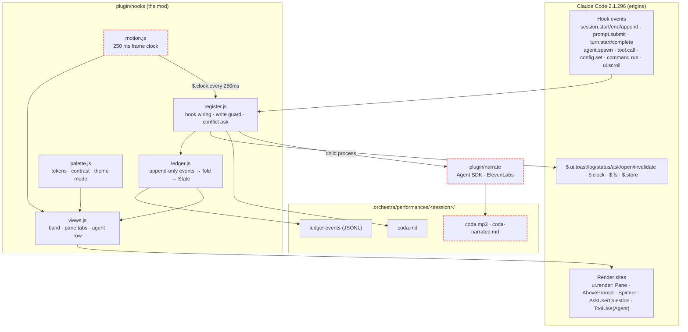
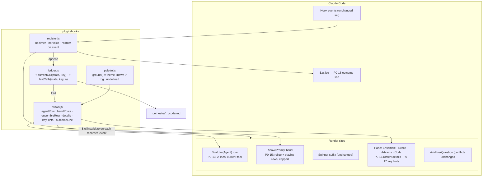
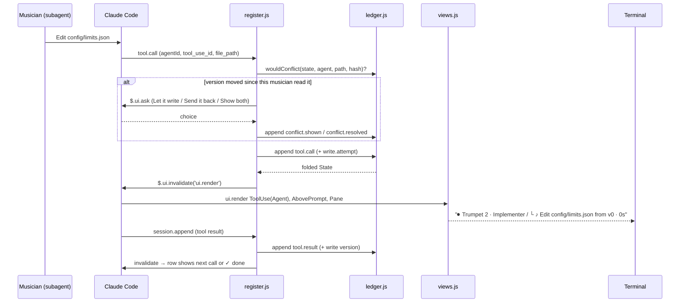
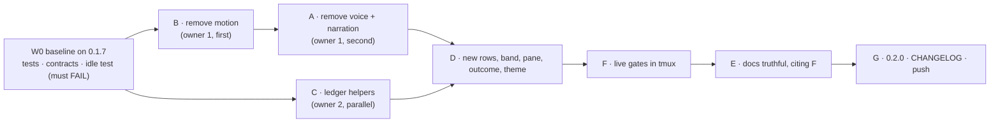

# Orchestra 0.2.0: system diagram and build plan

Status: **draft for owner review, revision 3**. Nothing here is built yet. Source of requirements: `docs/PRD-orchestra.md` (P0-12 to P0-21, P1-5, D1-D5). Source of patterns: `docs/tui-research.md`.

Revision 2 applies three independent reviews (code accuracy, PRD coverage, gate soundness; §8). All three rated revision 1 "incorrect": slice ownership was wrong, two gates could not run, and the idle test passed on the old code. Revision 3 closes the gaps found by the docs audit (`.planning/docs-audit/audit-a.md`, "Plan coverage" and "Unmapped items"): P0-12 now has an owning slice, P1-5 has a gate, drift-register dispositions and the P0-21 acceptance items are explicit, P0-14's W0 capture is a gate row, and P0-20 states the `unknown`-mode ground.

---

## 1. The system today (0.1.7, measured)

One Claude Code plugin. No server, no network, no child process except the narration/voice path that 0.2.0 removes.

| File | Lines | Role |
| --- | --- | --- |
| `plugin/hooks/register.js` | 1619 | Hook wiring, write guard, conflict dialog, toasts, command, render sites |
| `plugin/hooks/ledger.js` | 649 | Event types, `apply`/`fold`, derived state (conflicts, stale, handoffs, coda) |
| `plugin/hooks/views.js` | 411 | Draws band, pane tabs, agent row, held-write comparison |
| `plugin/hooks/motion.js` | 142 | 250 ms frame clock helpers: notes, baton, blink, pulse, travel, beat, meter, sustain |
| `plugin/hooks/palette.js` | 98 | Colour tokens, contrast, dark/light/256/ansi modes, pane ground |
| `plugin/narrate/{narrate,voice}.mjs` | 217 | Agent-SDK retelling and ElevenLabs MP3 (child process, network, key) |
| `plugin/agents/*.md` | 6 files | Conductor + 5 instruments (violin, trumpet, cello, flute, timpani) |
| `plugin/tests/ledger.test.ts` | 47 | Fold tests |



Red dashed = removed in 0.2.0.

## 2. The system after 0.2.0



**Contract: one redraw trigger.** The only redraw caused by work is the `$.ui.invalidate('ui.render')` in `recordIn` after an event is applied (`register.js:453`). The other redraws come from the person's own actions or from configuration: tab and selection changes (`:1549`, `:1553`), scroll (`:1561`), theme (`:1322`, `:1418`), session start and end (`:1163`, `:1182`). There is no key hook. The only timer that stays is the theme recheck (`:1350`), which only re-reads config.

**Contract: elapsed time.** `now` is `view.now`, the timestamp of the last recorded event, set in `recordIn` (`register.js:447`) as today. Render hooks never read the clock. Claude Code redraws its spinner on its own, and the Spinner hook draws Orchestra's text (`:1579-1583`), so reading the clock there would make Orchestra's text tick with no events, which P0-19 forbids.

**Contract: unknown theme.** `palette.js` gets a fifth mode, `unknown`. It is set when the theme read fails (`register.js:1349-1353`), and `ground()` returns `undefined` for it. Today `modeFor` always resolves to a mode (`palette.js:93-98`).

## 3. One event, end to end



## 4. Screen map (what each requirement changes)

```
⏺ Trumpet 2 · Implementer                                 ← P0-13 line 1   [ToolUse(Agent)]
  └ ♪ Edit config/limits.json from v0 · 12s               ← P0-13 line 2
✽ Bootstrapping… · 9 musicians playing (1m 51s · ↓ 9k)    ← unchanged      [Spinner]
𝄐 Orchestra  9 playing · 1 waiting on you · ‼ 1 conflict  ← P0-15 rollup   [AbovePrompt]
♪ Violin 2    Read   src/db/schema.sql · 0:40             ← P0-15 one row per not-done musician
‖ Trumpet 2   held   config/limits.json: v1 since your v0
  … 6 more · /orchestra                                    ← P0-15 cap
❯
┌ Orchestra ─ 1 Ensemble · 2 Score · 3 Artifacts · 4 Coda ┐  [Pane]
│ ♪ Trumpet 2  Implementer   Edit config/limits.json  12s │ ← P0-16 2-line roster
│   4 measures · 3 reads · 1 write                        │
│ 1-4 tabs · ↑↓ select · enter details · esc close        │ ← P0-17
└──────────────────────────────────────────────────────────┘
𝄐 Coda · 10 musicians · 7 files · 1 conflict · 0 failed · 3m10s · /orchestra coda   ← P0-18 [$.ui.log]
```

## 5. Work slices

Order is by dependency. A and B both edit `register.js` and `views.js`, so they run **one after the other in one worktree, under one owner**. Only C runs in parallel with them.



**Slice B: remove motion (P0-19).** Owner 1, first.
- Delete `plugin/hooks/motion.js`. First move the helpers that do not depend on the frame clock:
  - `elapsed`, `activity`, `lastCall` (with its local `newest`) go to `ledger.js`;
  - `eventText`, `recent`, `liveHandoff` go to `ledger.js`. They change only when events arrive (`liveHandoff` uses a window over event numbers, `motion.js:79-82`). The handoff becomes one static line, `Violin → Trumpet 2 · config/limits.json v1`; `travel()`, which moved an arrow by frame (`motion.js:86-90`), is dropped.
  - `meter` is dropped. It is not motion, because it changes only on events. It goes because it shows the same activity a second time as an unlabelled bar, next to the exact counts that P0-13 and P0-16 show (measures · reads · writes). omp and OpenCode show numbers, not bars.
- `register.js`:
  - re-point the import on `:9`;
  - drop `frame` and `live` from the view (`:177`);
  - delete the timer block, `moving()` and `syncMotion` (`:179-201`) and its call (`:452`);
  - remove `interactive` (`:181`, `:1340`). Only `moving()` reads it (`:184`);
  - in the ToolUse mark (`:1614`), replace `note(view.frame…)` with the fixed `♪`.
- `views.js`:
  - remove the frame and live paths from `glyphOf` (`:71-74`), `band` (`:77-89`), the stage, cue, pulse and transition code (`:154-167`), `handoffLine`/`travel` (`:183-194`), `seat` (`:214`) and the score's sustain, playhead and beat (`:284-291`);
  - remove the `:5` import.
- `.planning/contracts/`:
  - delete `motion.contract.mjs`;
  - rewrite `render-proof.mjs:55-75`: the same state drawn twice, with the clock advanced in between, gives identical output;
  - remove the held-note check from `prototype-replay.mjs:36`.

**Slice A: remove voice and narration (P0-21, D1).** Owner 1, second.
- Delete `plugin/narrate/`.
- `plugin.json` userConfig: remove the five options (`:10-46`).
- `register.js`:
  - state (`:51-53`, `:133-144`) and the view fields (`:172-177`);
  - coda dispatch (`:509-510`);
  - `narrate`, `spokenFrom`, `speakCoda` (`:517-610`);
  - resets (`:1146-1148`, `:1177-1180`);
  - options (`:1332-1338`);
  - `| voice |` in the command description (`:1342`);
  - the voice branch (`:1524-1531`).
- `views.js`: remove `narrationBlock` and `voiceBlock` (`:380-410`).
- `/orchestra <unknown>` replies `Unknown argument: <arg>. Use coda, ledger or close.` Today an unknown argument falls through to opening the pane (`:1532-1533`). `/orchestra voice` is one such argument and must get this reply (P0-21; gate rows "P0-21 userConfig" and "P0-21 voice argument").

**Drift-register dispositions (PRD:353-361).** Slice A carries the code-side ones; E carries the docs-side ones.
- `docs/asset-handout.md`: deleted. Slice E confirms it is gone and that no doc links to it; the P1-5 gate checks both. (If the file is still in the tree when E starts, E deletes it.)
- `prototype/`: frozen. It is not edited, not run by any gate, and not imported by `plugin/`. The docs describe it as history only.
- `.planning/contracts/motion.contract.mjs`: **deleted** (slice B). It tests the frame clock, which no longer exists.
- `.planning/contracts/prototype-replay.mjs`: **retired**. It replays the frozen `prototype/`, so it stays in the repo as a historical artefact, loses its held-note check (slice B), and is removed from every gate in §6. Nothing in §6 may import or run it.
- Browser checks: removed from `README.md`, `docs/guide.md`, `docs/orchestra-prd.md`, `docs/orchestra-spec.md` and `docs/verification.md` current-state text by slice E. Historical `verification.md` sections stay, marked as history.

**Slice C: ledger helpers.** Owner 2, parallel with B and A; `ledger.js` only. Owner 1 adds B's moved helpers after C lands.
- `currentCall(state, key)` returns the open `tool.call` that has no matching result.
- `lastCalls(state, key, n)` returns the last `n` calls, each paired with its result.
- `rollup(state)` returns the counts: playing, waiting on you, conflicts open, failed.
- `instanceName(state, key)` (P0-12) returns the display name for a musician: the role plus an instance number from the ledger fold, `Trumpet`, `Trumpet 2`, `Trumpet 3`…, numbered by order of first event in the session and stable for the rest of it (a replayed ledger gives the same numbers). It never returns `Guest` or an unnamed row; ten simultaneous musicians each get a distinct name. Tests: ten `agent.start` events across four roles give unique names; replaying the same events twice gives the same names.

**Slice D: draw the new surfaces.** It starts after A, B and C are committed.
- `views.js`: `agentRow` (two lines; the failed form `✕ failed · <first error line>`); `bandRows` (rollup + rows for the musicians not yet done, capped, `… N more · /orchestra`); the Ensemble tab as a roster with details on Enter; `keyHints`; `outcomeLine`.
- P0-12: every surface takes the name from `instanceName` and draws it in a fixed-width name column that is never truncated or wrapped: `agentRow`, `bandRows`, the Ensemble roster and details, `handoffLine`, `outcomeLine`, toasts and the Spinner suffix. No surface builds a name itself.
- `register.js` render hooks (`:1537-1619`): log the outcome line at turn end.
- `palette.js`: the `unknown` mode (P0-20). In `unknown` mode `ground()` returns `undefined`, so Orchestra paints **nothing**: no pane fill, no cell background anywhere. The pane draws foreground text only, on whatever the terminal and Claude Code show. Foreground colours fall back to the `ansi` set, which has no background dependence. The other four modes still paint their ground as today.
- P0-14 fallback, as the PRD mitigation (PRD:340) says: if the engine does not redraw each parallel Agent row, line 2 goes to the band and the Ensemble tab, and Claude Code's text is kept.

**Slice F: live gates (§6).** **E: docs** (P1-5) follow F, so that `docs/verification.md` can cite F's captures. E rewrites the current-state text in `README.md`, `docs/guide.md`, `docs/orchestra-prd.md`, `docs/orchestra-spec.md` and `docs/verification.md` so that voice, narration, ElevenLabs, motion, the baton, the frame timer, browser checks and asset handout appear only as removal or history text, and applies the drift-register dispositions above. README and the guide each get a section per surface P0-12 to P0-21 that cites an F capture (the P1-5 checklist row in §6), and both state that no voice, narration, network or browser feature exists (P0-21). **G:** create `CHANGELOG.md`, which does not exist yet, set `plugin.json:3` to `0.2.0`, commit, push, and install fresh in a clean `CLAUDE_CONFIG_DIR`.

**Out of scope for 0.2.0:** P1-1 to P1-4 and the P2 items (PRD:395). F records hook timings (G5 and P1-1) at no extra cost.

## 6. Verification gates

Every gate runs on 0.1.7 in W0 first. A gate that already passes on 0.1.7 is marked as **regression-only**; it cannot prove that the change worked.

| Gate | Command / action | Pass |
| --- | --- | --- |
| Unit | `claude plugin test ./plugin` (`docs/verification.md:212`) | All pass. Each new test is also run once against one deliberate fault (e.g. a call paired with the wrong result) and fails on an assertion, not an import error. |
| Types | `npx -y -p typescript tsc -p plugin --noEmit` (`verification.md:213`) | 0 errors |
| Validate | `claude plugin validate ./plugin` (`verification.md:211`) | Clean |
| Contracts | `node .planning/contracts/render-proof.mjs` and `node .planning/contracts/palette-proof.mjs` | Pass; render-proof asserts that output is the same at two clock times |
| Removed surface (P0-21, code) | grep `voice\|narrat\|elevenlabs\|clock\.every\|clock\.after\|setInterval\|\$\.process\|browser` over `plugin/hooks plugin/agents plugin/.claude-plugin/plugin.json plugin/tests README.md docs/guide.md` (not `types/`, not `.omc/`; the docs are covered by the P1-5 row) | Only the theme recheck, plus Non-Goals text in the docs |
| P0-14 W0 capture | In W0, on 0.1.7, run three parallel `Agent` calls in tmux and capture every 1 s while they run; record whether Claude Code 2.1.296 lets the mod redraw each parallel `Agent` row (distinct per-row content on screen) | Capture saved under `e2e-evidence/run-*-v020-w0/` with a yes/no answer. Yes: D draws line 2 on each Agent row and F re-captures it on 0.2.0. No: D takes the P0-14 fallback (band and Ensemble tab), P0-13 is gated on the band, and the drift register records it. |
| Idle (P0-19) | tmux: one musician playing but silent (Bash `sleep 75`), plus a pending conflict dialog; capture every 2 s for 60 s; diff only the rows Orchestra draws (Agent rows, band, pane, Orchestra's spinner suffix) | 0.1.7: **fails** (frames differ). 0.2.0: identical. |
| P0-12 numbering | Live run below, plus the ledger-helper unit test for `instanceName`; in the F capture read every surface (rows, band, Ensemble, handoff, outcome, toast) | Ten distinct names (`Trumpet`, `Trumpet 2`…), the same name for one musician on every surface, no `Guest`, no truncation. The unit test fails against the deliberate fault of two musicians sharing a number. |
| Live run | `.planning/live/record.sh`, clean `CLAUDE_CONFIG_DIR`, `--plugin-dir ./plugin`, fixture repo, scripted conductor prompt: 10 musicians; two trumpets edit `config/limits.json` (forced conflict, `verification.md:122`); one musician runs a failing command (forced failure) | Frames and ledger saved under `e2e-evidence/run-*-v020-*/`, with a requirement-to-frame map covering P0-12 to P0-21. No "Guest", every row named, no name truncated. The outcome line's counts equal the coda file's (G4). |
| P0-21 userConfig | `node -e` over `plugin/.claude-plugin/plugin.json`: list `userConfig` keys | No key matching `voice\|narrat\|eleven`; the five 0.1.7 options are gone (0.1.7: **fails**) |
| P0-21 voice argument | tmux: `/orchestra voice` in a live session | Reply `Unknown argument: voice. Use coda, ledger or close.`; the pane does not open (0.1.7: **fails**, it opens the pane) |
| P0-21 docs | grep README.md and docs/guide.md for the statement that no voice, narration, network or browser feature exists | Both state it, in current-state text |
| P1-5 stale text | grep -inE `voice\|narrat\|elevenlabs\|motion\|baton\|frame timer\|browser\|asset-handout` over `README.md docs/guide.md docs/orchestra-prd.md docs/orchestra-spec.md docs/verification.md`; then `test ! -e docs/asset-handout.md` | Every hit is removal, Non-Goals or history text (each hit reviewed by hand and listed in the E notes); `docs/verification.md` hits sit only in sections marked as history; the file is absent and nothing links to it |
| P1-5 checklist | Read README and the guide against the F captures | Each of P0-12, P0-13, P0-14, P0-15, P0-16, P0-17, P0-18, P0-19, P0-20 and P0-21 has a paragraph in README and in the guide that describes the surface and cites a named F capture under `e2e-evidence/run-*-v020-*/`; no paragraph describes a surface F did not capture; `docs/verification.md` has a 0.2.0 section citing the same captures |
| G9 sizes | The same run at 160×48 and 100×20 (PRD:90) | Glyph, name and time columns never wrap or truncate |
| G10 timing | Capture every 3 s, compared against the ledger's `tool.call` events (PRD:91) | Each row's current tool matches the ledger |
| Keys | tmux script: `1`–`4`, `↑↓`, Enter, Esc in the pane | A capture per tab (P0-17); details open on Enter (P0-16) |
| Themes | dark, light, 256 and ansi; unknown (theme read made to fail) | palette-proof ≥ 4.5:1; in the unknown theme `ground()` is `undefined` and the capture shows no pane fill and no cell backgrounds (P0-20). tmux reduces colour to 256, so truecolor is stated as unobserved (`verification.md:252`). |
| Regression P0-1..11 | Re-run the `verification.md` rows: `-p` auto send-back (P0-6), `--continue` rebuild (P0-9), Send it back / Show both (P0-5), stale and handoff toasts (P0-7) | Same results as 0.1.7 |

Open question carried from the PRD: whether Claude Code 2.1.296 lets the mod redraw **each** parallel `Agent` row (P0-14). The "P0-14 W0 capture" row answers it; if not, P0-13 falls back to the band and the drift register records it.

## 7. Risks

| Risk | Mitigation |
| --- | --- |
| Without the frame clock, elapsed times look frozen during a long silent tool call | Accepted by D2. Times are labelled as times since the last call started (PRD:342). Measured in F. |
| 10 rows exceed half the terminal height | Band cap + `… N more · /orchestra` (P0-15) |
| `register.js` and `views.js` edits from A and B collide | One owner, B then A, sequential commits |
| Live run costs and flakiness | One run per gate; captures saved under `e2e-evidence/`, never re-staged |

## 8. Review record

Three reviewers read revision 1 against the code; their full findings are at `agent://CodeAccuracy`, `agent://PrdCoverage` and `agent://VerifyPlan`.

| Finding | Raised by | Resolution (last row: revision 3) |
| --- | --- | --- |
| Motion reaches beyond `:192-200`, into `views.js` bodies and `:1614`; B and D overlapped | all three | B lists every site; D starts after B |
| Voice UI in `views.js:380-410` and register.js state were not in A | Code, Coverage | Added to A |
| `.planning/contracts` import motion.js | Code, Gates | Added to B and to the gates |
| `eventText`, `recent`, `liveHandoff`, `meter` were unplaced | Code | Placed |
| `bun test` / `bunx tsc` cannot run here | Gates | Repo's recorded commands |
| Grep matched vendored types and session state | Gates | Scoped paths |
| `/orchestra voice` would open the pane, not say "unknown" | Gates, Coverage | Unknown-argument reply added |
| Clock read in render would tick on spinner redraws | Coverage, Gates | `view.now` from events |
| Idle test passed on 0.1.7 | Gates | A playing-but-silent musician; must fail on 0.1.7 |
| G9 sizes and G10 timing missing; no forced failure; no key-driving; no P0-1..11 regression | Coverage, Gates | Added to §6 |
| No "unknown" theme state exists | Coverage | Contract and gate added |
| `:452` is `syncMotion`, invalidate is at `:453`; no key hook | Code | Corrected |
| No `CHANGELOG.md`; docs written before the live run | Gates | G creates it; E after F |
| P0-12 had a gate but no slice; P1-5 had no gate; drift-register dispositions, P0-21 acceptance items, the P0-14 capture and the `unknown` ground were unplaced | Docs audit (`audit-a.md`) | Revision 3: `instanceName` in C and D; P1-5 rows, P0-21 rows and the P0-14 W0 row in §6; dispositions in A and E; `unknown` ground in D |
