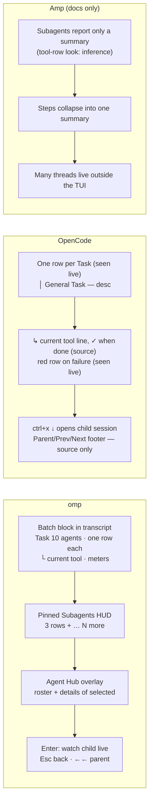

# How agent TUIs show a lead agent and its parallel workers

Research for Orchestra's terminal UI, 2026-10-12. The question: how do Amp, omp and OpenCode (the three the owner named), Claude Code itself, and other terminal UIs show a main agent with about ten parallel subagents? And which of those patterns can an Orchestra mod draw inside Claude Code?

The orchestra is only a picture of how the agents are arranged. Nothing here concerns sound.

## Evidence

All under `e2e-evidence/tui-research-20261012/` (gitignored).

The lead spot-checked each report against its frames or source:
- omp: every pattern row, re-read in its frame or source line;
- OpenCode: live frames 09 and 15 plus the cited source lines;
- Claude Code: the frames used here;
- Amp: three claims, against `help.txt` and two news posts;
- secondary tools: one claim per tool;
- canvas: all 55 `d.ts` citation rows;
- craft: four captures.

Claims beyond that are the report authors' and are marked as such.

| TUI | How it was seen | Report |
| --- | --- | --- |
| omp 18.10.3 | **Live**: 3, 4 and **10** parallel subagents ran to completion; Agent Hub; drill-in into a running child and back. Plus source. | `omp/report.md` |
| OpenCode 1.18.31 | **Live, partial.** Four parallel Task rows were drawn, twice. The children **failed**, because the user's global OpenCode plugins returned harness errors, so the agent fell back to reading the files itself. Drill-in keys were sent but the child view was **not observed**. Done, running and child-view behaviour come from **source**. | `opencode/live.md`, `opencode/source.md` |
| Claude Code 2.1.296 | **Live**, 4 parallel Agent calls, no plugins of ours | `others/claude/report.md` |
| Amp | **Docs only**: official manual, news posts, four TUI screenshots. It cannot run here, because its settings point at a local dev server. **No TUI frame with subagents running was found.** How Amp draws a subagent row is inference. | `amp/report.md` |
| Pi, Codex, Gemini CLI, Claude Squad, Crush | Source code | `others/report.md` |
| lazygit, htop, bottom, k9s, Charm, Ratatui, Textual | Live (lazygit, htop, bottom, k9s) and docs | `craft/report.md` |
| What a mod can draw | `claude-code.d.ts` + live mod docs | `canvas/report.md` |

## What the three named TUIs do



What the evidence supports, and how strongly:
1. **One row per worker, with identity and job.**
   - Seen live in omp (`• F07 Count words…`) and OpenCode (`│ General Task — Word count alpha.txt`).
   - Amp: no TUI frame; docs only say subagents return a summary.
2. **A second line with what the worker is doing now.**
   - Seen live in omp (`└ bash: Running word count · 16.2s`).
   - OpenCode draws `↳ <Tool> <title>` while a child runs, but in source only (`routes/session/index.tsx:2276-2281`); the children failed before any showed.
   - Amp: not seen.
3. **State in a glyph at the line start, colour second.**
   - omp, live: `•`, done and failed states.
   - OpenCode, live: a failed row turns red, both `│` and title (`38;2;255;59;59`).
   - OpenCode, source: `│` running, `✓` done.
   - Also in Gemini, Codex and Claude Squad source.
4. **Collapse by default, expand on one key.**
   - omp, live: `… 6 more agents (6 pending) ⟨O: Expand⟩`.
   - OpenCode, source: 3 or 10 lines plus `…`.
   - Amp, news post: about ten step rows become one summary.
5. **An outcome footer per batch.**
   - omp, gallery: `⟨1 succeeded · 6 req · 48.2s⟩`.
   - Pi, source: `✓ parallel 8/8 tasks`.
6. **Drill into one worker and come back.**
   - omp, live: Enter, Esc, `←←`.
   - Claude Code, live: `ctrl+o`.
   - OpenCode: `ctrl+x ↓` is in source only; it was not observed.
7. **Motion.** The tools differ.
   - OpenCode runs two moving things at once: a braille spinner at 80 ms and a block "scanner" at 40 ms in the footer (live frames 03–19).
   - Claude Code moves only its spinner.
   - Amp (`amp.terminal.animation`, `NO_ANIMATION=1`) and OpenCode (`animations_enabled`, `component/spinner.tsx:17`) let users turn animation off; lazygit only lets users turn off one decorative effect (`animateExplosion`).
   - Orchestra adding **no** motion of its own is our design decision (spec:495, D2), not a pattern all three share.

## What Claude Code already shows (the ground Orchestra stands on)

Captured live, `others/claude/07-run-04.txt`:

```
⏺ Agent(Count words in alpha.txt)
  ⎿  Backgrounded agent (↓ to manage · ctrl+o to expand)
  …×4
✽ Bootstrapping… (12s · ↓ 1.2k tokens)
❯
  ⏵⏵ auto mode on · /tasks to see subagents · ← 5 agents
  ⏺ main
  ◯ general-purpose  Count words in alpha.txt              10s · ↓ 141.2k tokens
  ◯ general-purpose  Count words in bravo.txt              10s · ↓ 141.2k tokens
```

- Claude Code **already lists the running subagents below the prompt**, with type, task, elapsed time and tokens. Rows disappear as each finishes. Orchestra must not draw a second copy of that list.
- In 2.1.296, **each parallel Agent call gets its own `⏺ Agent(…)` row** (frame `04-run-01`). Known limitation 1 in `docs/verification.md:249` says parallel starts collapse into one summary row. That is no longer true on this version. Whether these rows can be redrawn as instrument rows needs a live mod test.
- What the native list lacks is exactly what Orchestra adds:
  - **who** each worker is (instrument name and colour, not `general-purpose`);
  - **which file and version** it is reading or writing;
  - **clashes** (conflicts, stale reads);
  - **handoffs**;
  - **a result taken from the record** (the coda).

## Decisions, mapped to where a mod can draw

Render sites and limits come from `canvas/report.md`:
- The band (`AbovePrompt`) is capped at half the terminal height and scrolls past `maxRows`.
- The pane docks from 110 columns, and otherwise sits above the prompt.
- `ToolUse` rows can be redrawn.
- Toast and status lines are plain, uncoloured strings.
- No redraws faster than 10 per second, or 30 for visible regions.
- A mod cannot own the screen or open a child transcript.

| # | Pattern (source) | Decision | Orchestra site |
| --- | --- | --- | --- |
| 1 | One row per worker, identity + task (omp live; OpenCode live; Amp: docs, row look not seen) | **Adopt.** `Trumpet 2  <part brief>`. The name is the identifier (G7); colour is second. | Agent `ToolUse` row; band; Ensemble tab |
| 2 | Second line = current tool and target (omp live `└ bash: …`; OpenCode source `↳ <Tool> <title>`, `index.tsx:2276-2281`) | **Adopt.** `└ Edit src/limiter.js · 12s`. This is the most useful line, and Claude Code's own list lacks it. | Agent row; band; Ensemble |
| 3 | Fixed glyph column for state (Gemini 3 columns, Codex `•`, Squad `●/⏸`) | **Adopt the fixed column; keep the spec's glyphs** (`views.js:8`, spec S1): `· resting`, `♪ playing`, `‖ waiting on you`, `✓ done`, `✕ failed`, plus the alerts `‼ conflict` and `⚠ stale`. Every glyph is followed by its word. | Every roster row |
| 4 | Rollup line above the rows (Pi `⏳ parallel 3/8 done, 2 running`, omp `waiting on 3 of 10 · 2 done · 1 failed`, htop `16 running`) | **Adopt** as the band's first line: `Orchestra  6 playing · 3 done · 1 failed · ‼ 1 conflict` | Band line 1; status line |
| 5 | Pinned HUD with a cap + `… N more` (omp, 3 rows) | **Adapt.** The band shows the rollup plus one row per *playing* musician, up to `maxRows − 1`, then `… N more · /orchestra`. Done musicians leave the band, as Claude Code's own list does. | Band |
| 6 | Roster + details of the selected worker (omp Agent Hub, Claude Squad, lazygit) | **Adopt** in the pane. The Ensemble tab is a roster of two-line rows (state, name, task / current tool, meters). Enter opens that musician's details below it: part, versions seen, reads/writes, recent tool calls with times. | Pane › Ensemble |
| 7 | Drill into the child's full transcript (omp live; OpenCode source only, not observed) | **Reject for the mod; point to Claude Code.** A mod cannot open a child transcript. The details row says `full transcript: ← agents`. | Pane hint |
| 8 | Per-worker meters (omp `· 4 tools · 1 req · 0.0%/1M`, Pi `↑12k ↓3k`) | **Adapt** to what the ledger knows: `4 measures · 2 reads · 1 write · 41s`. Tokens and cost stay in Claude Code's own list; no duplication. | Agent row (done); Ensemble |
| 9 | Batch outcome footer (omp `⟨1 succeeded …⟩`, Pi `✓ parallel 8/8`) | **Adopt** as the coda line in the transcript: `𝄐 Coda · 10 musicians · 7 files · 1 conflict (resolved) · 0 failed · 3m10s` | Transcript log line; Coda tab |
| 10 | Collapse by default, one key expands (omp live; OpenCode source; Amp news post) | **Adopt.** Agent rows are 2 lines; the engine's `ctrl+o` expands. Coda tab: counts first, lists below. | All |
| 11 | Error = same row, recoloured red (OpenCode live, frames 09/15; Codex source) | **Adopt.** `✕ failed` + red + the first error line. No separate error block. | Agent row; band; Ensemble |
| 12 | Motion: OpenCode runs two moving indicators; Claude Code one spinner; Amp and OpenCode let users turn animation off | **Design decision: draw no motion of our own** (spec:495, D2). Claude Code's spinner already shows that work is happening; this is not copied from any peer. | — |
| 13 | Transparent or system theme following the terminal (OpenCode `system`, k9s `default`) | **Adopt** with D3. Text colours come from the detected dark/light theme. The docked pane fill follows that theme, because Claude Code otherwise fills it grey. | Pane; palette |
| 14 | Key hints in the footer that change with focus (lazygit live; Amp screenshot of a modal; OpenCode live `esc interrupt · ctrl+p commands`) | **Adopt.** The pane's last row: `1-4 tabs · ↑↓ select · enter details · esc back`. | Pane |
| 15 | Staves of events per worker (Orchestra's Score tab) | **Keep (spec S6), no peer has it.** Static lanes, no playhead or beat. | Pane › Score |
| 16 | Separate thread-management app for many agents (Amp web app, omp hub) | **Reject.** Orchestra lives only in the terminal. | — |

## Ten at once

**omp (observed with 10).**
- The transcript block reads `Task 10 agents` with `… 6 more agents (6 pending) ⟨O: Expand⟩` and the 4 newest rows.
- The status line shows `10`.
- The Agent Hub lists all ten, two lines each, with totals.

**Orchestra's equivalent.** With ten musicians playing on a 48-row terminal, the band has at most 24 rows, so all ten rows fit (11 rows including the rollup):

```
𝄐 Orchestra  9 playing · 1 waiting on you · ‼ 1 conflict            band line 1: rollup
♪ Violin      Read  src/api/routes.ts · 0:42                        one row per musician not yet done
♪ Violin 2    Read  src/db/schema.sql · 0:40
♪ Trumpet     Edit  src/limiter.js from v1 · 0:12
‖ Trumpet 2   held  config/limits.json: Trumpet wrote v1 since you read v0
♪ Flute       Write docs/limits.md · 0:31
  … 5 more rows of the same shape
```

- One row per musician: state glyph, name, current tool, target and version, elapsed.
- On a short terminal (for example 20 rows, so a band of at most 10), rows past the cap fold into `… N more · /orchestra`.
- The pane's Ensemble tab lists all ten and scrolls.

## What this changes in the current build

`plugin/hooks/views.js` at 0.1.7 draws these, which the spec rules out ("Orchestra draws no animation of its own", spec:495). Each is slated for removal by D2:
- the stage's baton, the pulse line and the travelling handoff arrow (`views.js:154-195`);
- the cycling note and blinking marks (`:71-74`);
- the Score playhead and beat (`:284-291`).

It also draws a narration block and a voice block (`:380-411`), slated for removal by D1 and P0-21.

What it lacks, compared with what omp showed live and OpenCode's source draws:
- the **current tool + target** as its own line under each musician (rows 2 and 5);
- a band that shows **only playing musicians** with a cap (row 5);
- an **outcome line** in the transcript (row 9);
- **key hints** in the pane (row 14).
